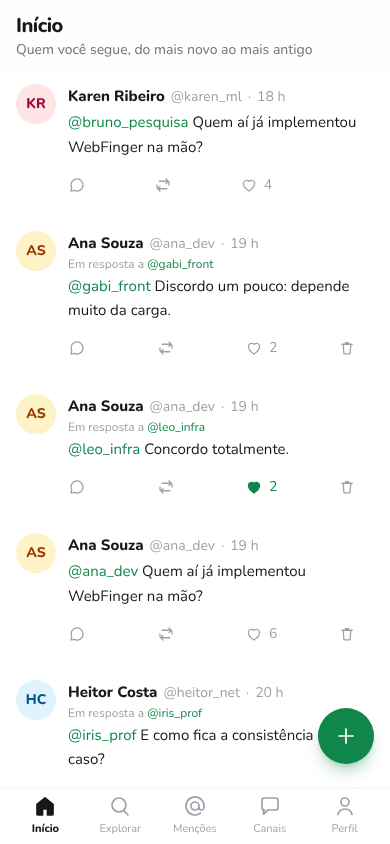
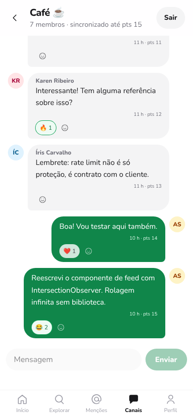
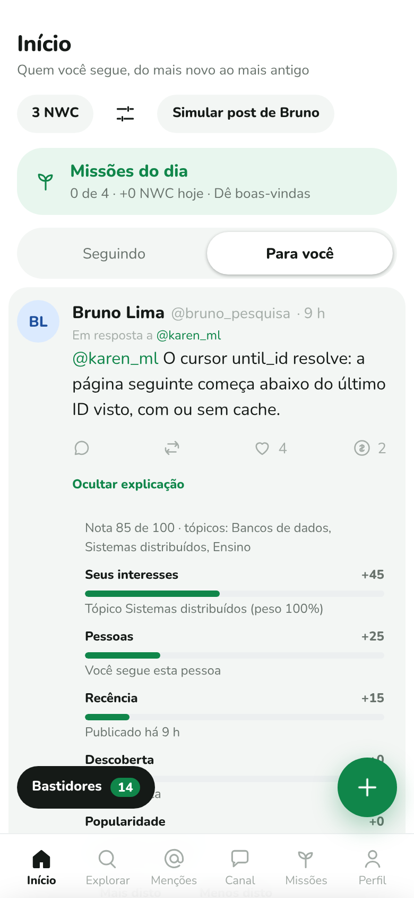
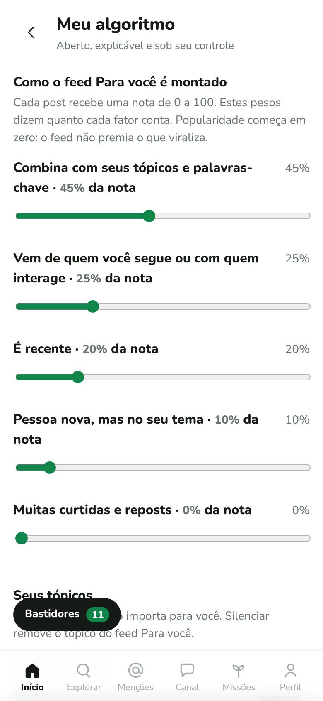
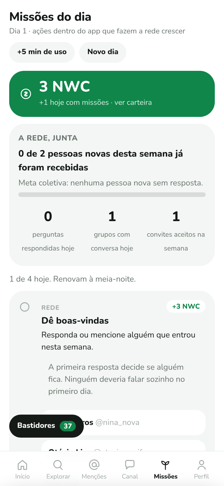
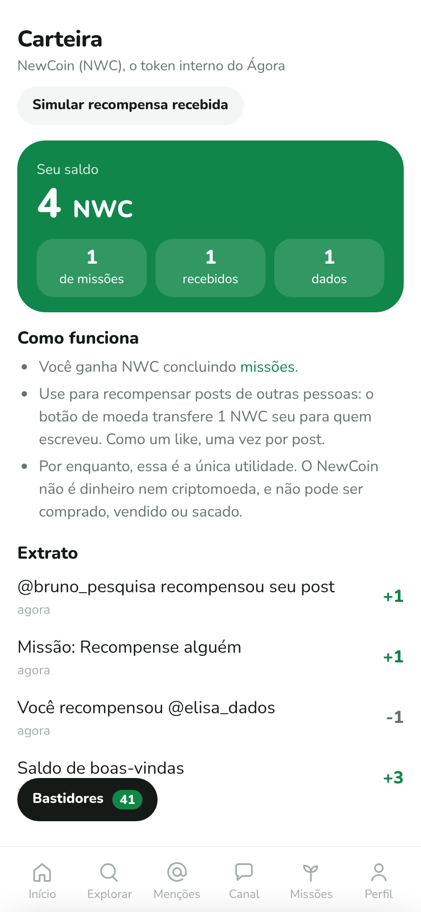
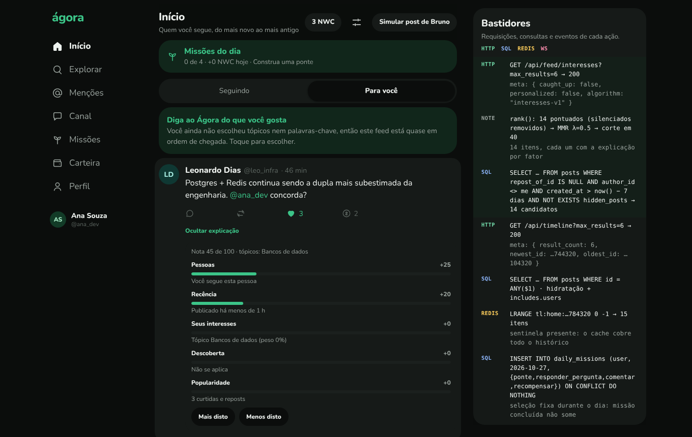

# Ágora: protótipo de rede social federável (pesquisa)

> **Uso exclusivamente acadêmico, para testes e provas de conceito.** Não é comercializado nem distribuído publicamente. Deve rodar em `localhost` ou rede privada. Nenhuma API real do X ou do Telegram é chamada, nada é coletado por scraping e nenhum código proprietário é usado: o estudo se baseia em **comportamento observável e documentação pública**.

Ágora junta as duas vertentes analisadas:

- **Feed no estilo X/Twitter:** home "Seguindo" em ordem cronológica reversa, threads, menções, perfis, follow, like e repost. Usa IDs Snowflake, paginação por cursor (`since_id`/`until_id`), fan-out na escrita em Redis e o formato de resposta `data` + `includes` + `meta`.
- **Mensageria no estilo Telegram:** canais (broadcast) e grupos em tempo real, com `pts` por canal para detectar e recuperar lacunas, reações com emoji e papéis owner/admin/member. Grupo é só de quem entrou, e quem administra pode remover pessoas.
- **Visitantes só leem:** timeline, posts, threads, perfis, a aba Brasil e as regras são abertos a quem não tem conta. Curtir, repostar, responder, recompensar e seguir pedem login, que leva de volta à mesma página.
- **Federável:** handles `usuario@instancia`, WebFinger e um outbox ActivityStreams somente leitura.
- **Algoritmo aberto:** aba "Para você" ordenada pelos interesses que a pessoa declara, com explicação em cada post, controles completos, aprendizado só por ações explícitas e um fim de sessão ("Você está em dia"). Popularidade vale zero por padrão. O algoritmo de cada pessoa fica **só no aparelho dela**: o navegador guarda as preferências e o aprendizado e faz a conta com o código aberto de `shared/ranking/`. Ao voltar ao app, ele é carregado do aparelho; a instância não sabe do que a pessoa gosta.
- **Moderação:** silenciar (privado), bloquear (nos dois sentidos, também dentro dos grupos) e denunciar posts ou contas pelo menu "⋯". A denúncia vai para a fila de quem modera a instância, que arquiva, remove o post ou suspende a conta, e quem denunciou acompanha o resultado. As **regras da instância** são públicas, aceitas no cadastro e citadas em toda decisão; quem foi afetado pode **recorrer** uma vez (até quem foi suspenso, pela tela de entrar).
- **Brasil em dados:** uma aba só com números da realidade: inflação, custo da cesta básica, desemprego, crescimento da economia e juros. Os números são os últimos publicados por IBGE, Banco Central e DIEESE, conferidos à mão em outubro de 2026 (`backend/src/official/registro.js`) e sem atualização automática. Cada cartão traz selo, data de publicação, link para a fonte e onde mais o número foi conferido ("De onde vem este número?").
- **Missões diárias e token interno:** até 4 missões por dia feitas dentro do app (curtir, republicar, comentar, recompensar, tempo ativo, receber quem chegou, responder perguntas, abrir grupos, convidar), verificadas pelas ações reais. Cada uma rende **NewCoin (NWC)**, um token interno que só serve, por enquanto, para recompensar posts de outras pessoas (transferência de 1 NWC, como um like). Sem usar o app, o saldo **evapora** aos poucos e zera em 7 dias. Sem sequências nem ranking. Convites de uso único.

| Início (celular) | Novo post | Canal em tempo real |
|---|---|---|
|  |  |  |

Visual mobile first e minimalista, com fonte arredondada (Nunito). No desktop, a navegação vira coluna lateral ([print no tema escuro](docs/img/desktop-dark.png)).

## Demo interativa

Uma página única que roda no navegador, sem servidor, com os mesmos dados fictícios do seed. Ela simula o app inteiro: feed **Seguindo** e **Para você**, a tela **Meu algoritmo**, threads, canal em tempo real, **missões do dia** e a **carteira NWC**. O painel **Bastidores** mostra, a cada ação, as requisições HTTP, as consultas SQL, os comandos Redis e os eventos de WebSocket que o backend real faria.

| Para você, com explicação | Meu algoritmo | Missões do dia | Carteira NWC |
|---|---|---|---|
|  |  |  |  |



**Como abrir:** baixe ou clone o repositório e abra [`demo/index.html`](demo/index.html) no navegador. Não precisa instalar nada nem rodar backend, e funciona sem internet (só a fonte Nunito vem do Google Fonts; sem conexão, a página usa a fonte arredondada do sistema). O GitHub mostra o código do arquivo, não a página. A demo é uma cópia estática para apresentação; o app de verdade está em `backend/` e `frontend/`.

Também há uma versão publicada em https://claude.ai/artifact/1KYADm2kxRoJqg8rsX6H9d (link privado: só abre para quem recebeu acesso).

## Entregáveis

| # | Entregável | Onde |
|---|---|---|
| 1 | Análise do X/Twitter (fluxos, endpoints v2, paginação, limites, schema do Post) | [`docs/01-analise-x-twitter.md`](docs/01-analise-x-twitter.md) |
| 2 | Análise do Telegram (MTProto 2.0, métodos RPC, autenticação/2FA, histórico, reações, mídia) | [`docs/02-analise-telegram.md`](docs/02-analise-telegram.md) |
| 3 | **Documento de arquitetura** (componentes, ER e fluxos em Mermaid, API) | [`docs/03-arquitetura.md`](docs/03-arquitetura.md) |
| 4 | **Relatório comparativo** (aprendizados e como foram aplicados) | [`docs/04-relatorio-comparativo.md`](docs/04-relatorio-comparativo.md) |
| 5 | Suposições, limites e decisões | [`docs/05-suposicoes-e-limites.md`](docs/05-suposicoes-e-limites.md) |
| 6 | Metodologia com Claude Code | [`docs/06-metodologia-claude-code.md`](docs/06-metodologia-claude-code.md) |
| 7 | **Atenção e algoritmo aberto** (gatilhos de recompensa nas redes e o feed "Para você" controlado pelo usuário) | [`docs/07-atencao-e-algoritmo-aberto.md`](docs/07-atencao-e-algoritmo-aberto.md) |
| 8 | **Missões diárias de organização popular** (crescimento orgânico, sem pontos nem sequências) e convites | [`docs/08-missoes-organizacao-popular.md`](docs/08-missoes-organizacao-popular.md) |
| 9 | **Token interno NewCoin** (recompensa entre pessoas, emissão só por missões, utilidade nula no início) | [`docs/09-token-interno.md`](docs/09-token-interno.md) |
| 10 | **Segurança e DoS** (análise, medições e correções propostas) | [`docs/10-seguranca-e-dos.md`](docs/10-seguranca-e-dos.md) |
| 11 | **Moderação** (silenciar, bloquear, denunciar e a fila da moderação, em linguagem simples) | [`docs/11-moderacao.md`](docs/11-moderacao.md) |
| 12 | **Regras da instância e recursos** (decisões citam a regra; recurso aceito desfaz a decisão) | [`docs/12-regras-e-recursos.md`](docs/12-regras-e-recursos.md) |
| 13 | **Informação oficial e verificação tripla** (análise: fontes abertas do desenvolvimento brasileiro integradas ao app) | [`docs/13-informacao-oficial-e-verificacao.md`](docs/13-informacao-oficial-e-verificacao.md) |
| 14 | **Análise de brechas por módulo** (reengenharia do app atrás de falhas exploráveis, com as correções feitas) | [`docs/14-analise-de-brechas-por-modulo.md`](docs/14-analise-de-brechas-por-modulo.md) |
| 15 | **Simulações de uso** (100 cenários automatizados conferindo o app contra os documentos) | [`docs/15-simulacoes-de-usabilidade.md`](docs/15-simulacoes-de-usabilidade.md), [`backend/sim/`](backend/sim) |
| 16 | **Código-fonte** (backend e frontend) | [`backend/`](backend), [`frontend/`](frontend) |
| 17 | **Script de seed** (usuários e posts fictícios) | [`backend/src/seed.js`](backend/src/seed.js) |

## Stack

| Camada | Tecnologia |
|---|---|
| Frontend | React 19, React Router, Tailwind CSS 4, Vite |
| Backend | Node.js 20+, Express 5, zod, JWT, bcrypt |
| Dados | PostgreSQL 14+ (fonte da verdade); Redis (timelines e rate limit, **opcional**) |
| Tempo real | Socket.io |
| Testes | Vitest, Supertest, Testing Library (+ Playwright para a checagem ponta a ponta) |

## Como rodar

Pré-requisitos: Node 20+ e Docker (ou Postgres e Redis instalados localmente).

```bash
# 1. Infraestrutura (Postgres em :5432 com os bancos social e social_test; Redis em :6379)
docker compose up -d

# 2. Backend
cd backend
cp .env.example .env   # JWT_SECRET vazio = segredo aleatório a cada início (só em dev)
npm install
npm run seed        # cria o schema e popula com dados fictícios
npm run dev         # http://localhost:4000

# 3. Frontend (outro terminal)
cd frontend
npm install
npm run dev         # http://localhost:5173  (faz proxy de /api e /socket.io para :4000)
```

Entre com o e-mail **`ana_dev@exemplo.test`** e a senha **`senha1234`**. Todos os usuários do seed seguem o padrão `<usuário>@exemplo.test` e usam essa senha. Para sair, use o botão **Sair** (no celular, fica no seu perfil). A Ana modera a instância de teste: em **Perfil › Fila da moderação** há uma conta de spam fictícia (`promo_rapida`) já denunciada. Para ver o tempo real, abra uma janela anônima com `bruno_pesquisa`, poste algo e veja o aviso "Mostrar 1 post novo" aparecer para a Ana. Ou converse no canal **Café ☕**.

Sem Redis, apague `REDIS_URL` do `.env`: o feed passa a ser montado só via SQL, com o mesmo resultado.

### Testes

```bash
cd backend  && npm test   # 213 testes: unitários + integração (precisa de Postgres e Redis; banco social_test)
cd frontend && npm test   # 70 testes: lógica e componentes (jsdom)
```

No GitHub, os testes do backend e do frontend (e o build do frontend) rodam em cada PR (`.github/workflows/ci.yml`).

Para usar outros bancos nos testes, defina `TEST_DATABASE_URL` e `TEST_REDIS_URL`. Os testes de integração **apagam** o banco de teste e o banco 1 do Redis.

As 100 simulações de usabilidade (76 de API, 24 de interface) ficam em `backend/sim/`: `npm run sim:api` e `npm run sim:ui` (com o app rodando). Resultado e achados em [`docs/15`](docs/15-simulacoes-de-usabilidade.md).

## Exemplos de API

```bash
TOKEN=$(curl -s localhost:4000/api/auth/login -H 'content-type: application/json' \
  -d '{"email":"ana_dev@exemplo.test","password":"senha1234"}' | jq -r .token)

# O token de acesso dura 15 min; o app renova sozinho pelo cookie de sessão.
# Home "Seguindo", 5 por página
curl -s "localhost:4000/api/timeline?max_results=5" -H "authorization: Bearer $TOKEN" | jq '.meta'
# → { "result_count": 5, "newest_id": "…", "oldest_id": "…", "next_token": "…" }

# Próxima página
curl -s "localhost:4000/api/timeline?max_results=5&until_id=<next_token>" -H "authorization: Bearer $TOKEN"

# Responder a um post (thread)
curl -s localhost:4000/api/posts -H "authorization: Bearer $TOKEN" -H 'content-type: application/json' \
  -d '{"text":"Concordo!","reply_to_id":"<id>"}'

# Mensagens perdidas desde o pts 10 num canal
curl -s "localhost:4000/api/channels/cafe/difference?pts=10" -H "authorization: Bearer $TOKEN"

# Descoberta federada
curl -s "localhost:4000/.well-known/webfinger?resource=acct:ana_dev@localhost:4000"
```

A tabela completa de rotas e eventos de tempo real está em [`docs/03-arquitetura.md` §4](docs/03-arquitetura.md#4-api-resumo).

## Estrutura

```
backend/    API Express, serviços de domínio, Socket.io, schema SQL, seed, testes
demo/       demo interativa em uma página HTML (sem servidor)
shared/     código puro usado pelo backend e pelo navegador (algoritmo "Para você")
frontend/   SPA React (Feed, PostCard, Composer, Thread, Perfil, Canais)
docs/       análises, arquitetura (Mermaid), relatório comparativo, suposições
```
