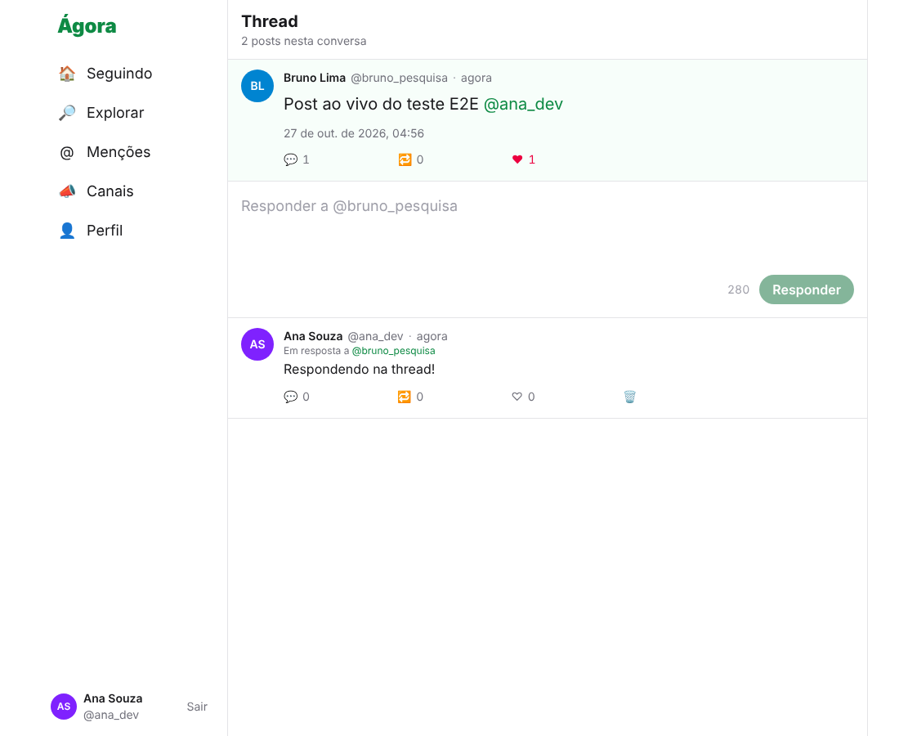

# Ágora: protótipo de rede social federável (pesquisa)

> **Uso exclusivamente acadêmico, para testes e provas de conceito.** Não é comercializado nem distribuído publicamente. Deve rodar em `localhost` ou rede privada. Nenhuma API real do X ou do Telegram é chamada, nada é coletado por scraping e nenhum código proprietário é usado: o estudo se baseia em **comportamento observável e documentação pública**.

Ágora junta as duas vertentes analisadas:

- **Feed no estilo X/Twitter:** home "Seguindo" em ordem cronológica reversa, threads, menções, perfis, follow, like e repost. Usa IDs Snowflake, paginação por cursor (`since_id`/`until_id`), fan-out na escrita em Redis e o formato de resposta `data` + `includes` + `meta`.
- **Mensageria no estilo Telegram:** canais (broadcast) e grupos em tempo real, com `pts` por canal para detectar e recuperar lacunas, reações com emoji e papéis owner/admin/member.
- **Federável:** handles `usuario@instancia`, WebFinger e um outbox ActivityStreams somente leitura.

| Home "Seguindo" | Thread | Canal em tempo real |
|---|---|---|
|  |  |  |

## Entregáveis

| # | Entregável | Onde |
|---|---|---|
| 1 | Análise do X/Twitter (fluxos, endpoints v2, paginação, limites, schema do Post) | [`docs/01-analise-x-twitter.md`](docs/01-analise-x-twitter.md) |
| 2 | Análise do Telegram (MTProto 2.0, métodos RPC, autenticação/2FA, histórico, reações, mídia) | [`docs/02-analise-telegram.md`](docs/02-analise-telegram.md) |
| 3 | **Documento de arquitetura** (componentes, ER e fluxos em Mermaid, API) | [`docs/03-arquitetura.md`](docs/03-arquitetura.md) |
| 4 | **Relatório comparativo** (aprendizados e como foram aplicados) | [`docs/04-relatorio-comparativo.md`](docs/04-relatorio-comparativo.md) |
| 5 | Suposições, limites e decisões | [`docs/05-suposicoes-e-limites.md`](docs/05-suposicoes-e-limites.md) |
| 6 | Metodologia com Claude Code | [`docs/06-metodologia-claude-code.md`](docs/06-metodologia-claude-code.md) |
| 7 | **Código-fonte** (backend e frontend) | [`backend/`](backend), [`frontend/`](frontend) |
| 8 | **Script de seed** (usuários e posts fictícios) | [`backend/src/seed.js`](backend/src/seed.js) |

## Stack

| Camada | Tecnologia |
|---|---|
| Frontend | React 19, React Router, Tailwind CSS 4, Vite |
| Backend | Node.js 20+, Express 5, zod, JWT, bcrypt |
| Dados | PostgreSQL 14+ (fonte da verdade); Redis (timelines e rate limit, **opcional**) |
| Tempo real | Socket.io |
| Testes | Vitest, Supertest, Testing Library (+ Playwright para a checagem ponta a ponta) |

## Como rodar

Pré-requisitos: Node 20+ e Docker (ou Postgres e Redis instalados localmente).

```bash
# 1. Infraestrutura (Postgres em :5432 com os bancos social e social_test; Redis em :6379)
docker compose up -d

# 2. Backend
cd backend
cp .env.example .env
npm install
npm run seed        # cria o schema e popula com dados fictícios
npm run dev         # http://localhost:4000

# 3. Frontend (outro terminal)
cd frontend
npm install
npm run dev         # http://localhost:5173  (faz proxy de /api e /socket.io para :4000)
```

Entre com **`ana_dev` / `senha1234`** (todos os usuários do seed usam essa senha). Para ver o tempo real, abra uma janela anônima com `bruno_pesquisa`, poste algo e veja o aviso "Mostrar 1 post novo" aparecer para a Ana. Ou converse no canal **Café ☕**.

Sem Redis, apague `REDIS_URL` do `.env`: o feed passa a ser montado só via SQL, com o mesmo resultado.

### Testes

```bash
cd backend  && npm test   # 50 testes: unitários + integração (precisa de Postgres e Redis; banco social_test)
cd frontend && npm test   # 20 testes: lógica e componentes (jsdom)
```

Para usar outros bancos nos testes, defina `TEST_DATABASE_URL` e `TEST_REDIS_URL`. Os testes de integração **apagam** o banco de teste e o banco 1 do Redis.

## Exemplos de API

```bash
TOKEN=$(curl -s localhost:4000/api/auth/login -H 'content-type: application/json' \
  -d '{"login":"ana_dev","password":"senha1234"}' | jq -r .token)

# Home "Seguindo", 5 por página
curl -s "localhost:4000/api/timeline?max_results=5" -H "authorization: Bearer $TOKEN" | jq '.meta'
# → { "result_count": 5, "newest_id": "…", "oldest_id": "…", "next_token": "…" }

# Próxima página
curl -s "localhost:4000/api/timeline?max_results=5&until_id=<next_token>" -H "authorization: Bearer $TOKEN"

# Responder a um post (thread)
curl -s localhost:4000/api/posts -H "authorization: Bearer $TOKEN" -H 'content-type: application/json' \
  -d '{"text":"Concordo!","reply_to_id":"<id>"}'

# Mensagens perdidas desde o pts 10 num canal
curl -s "localhost:4000/api/channels/cafe/difference?pts=10" -H "authorization: Bearer $TOKEN"

# Descoberta federada
curl -s "localhost:4000/.well-known/webfinger?resource=acct:ana_dev@localhost:4000"
```

A tabela completa de rotas e eventos de tempo real está em [`docs/03-arquitetura.md` §4](docs/03-arquitetura.md#4-api-resumo).

## Estrutura

```
backend/    API Express, serviços de domínio, Socket.io, schema SQL, seed, testes
frontend/   SPA React (Feed, PostCard, Composer, Thread, Perfil, Canais)
docs/       análises, arquitetura (Mermaid), relatório comparativo, suposições
```
