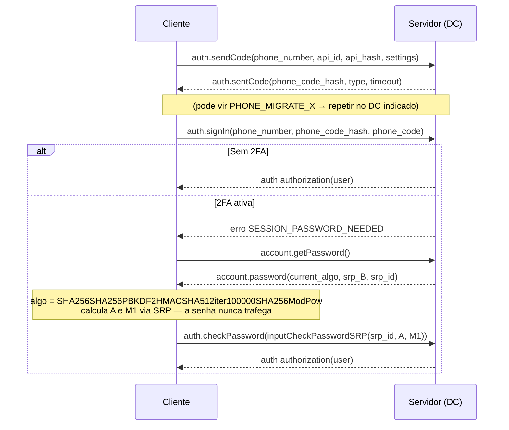

# Fase 2 — Análise de protocolo e mensageria do Telegram (MTProto 2.0)

> **Escopo.** Baseado na documentação pública em `core.telegram.org` (protocolo, schema TL, métodos) e no comportamento observável dos clientes oficiais, que são de código aberto. **O protótipo não implementa um cliente MTProto e não usa nenhuma conta do Telegram.** O objetivo é entender o desenho e aplicar as ideias num sistema próprio. Quem for experimentar a API real deve usar as próprias credenciais (`api_id`/`api_hash` de my.telegram.org), seguir os Termos da API e respeitar os erros `FLOOD_WAIT_X`. Usar a API para spam, inflar números ou coletar dados em massa viola esses termos.

## 1. Visão geral do MTProto 2.0

O MTProto é um protocolo binário com três camadas:

| Camada | Responsabilidade |
|---|---|
| **Alto nível (API)** | Chamadas RPC e tipos descritos em **TL (Type Language)**: `messages.getHistory`, `channels.joinChannel`, construtores como `message`, `peerChannel`… |
| **Criptografia e autorização** | Chave de autorização (`auth_key`, 2048 bits) negociada por Diffie-Hellman (`req_pq_multi` → `req_DH_params` → `set_client_DH_params`). Cada mensagem vai cifrada com **AES-256-IGE**. A chave e o IV saem da `auth_key` e do `msg_key`, que no MTProto 2.0 são os 128 bits do meio de um SHA-256 calculado sobre parte da `auth_key` e o texto com padding. |
| **Transporte** | TCP (variantes *abridged*, *intermediate*, *padded intermediate*, *full*), versões ofuscadas, HTTP(S) e WebSocket (usado pelos clientes web). |

Conceitos de sessão que influenciaram o protótipo:

- **`msg_id`**: aproximadamente `unix_time * 2^32`, monotônico. Também é um ID "ordenável por tempo", a mesma ideia do Snowflake.
- **`server_salt`** e **`session_id`**: proteção contra repetição e identificação da sessão lógica.
- **Data centers (DC1–DC5)**: cada conta "mora" num DC. Os erros `PHONE_MIGRATE_X`, `USER_MIGRATE_X` e `FILE_MIGRATE_X` dizem para onde redirecionar a chamada.
- **Camadas (layers)**: o schema TL é versionado por número de layer. O cliente declara qual usa com `invokeWithLayer(layer, initConnection(...))`. O enunciado cita a **Layer 225**. Esse número muda com frequência e não foi verificado aqui: confira em `core.telegram.org/schema`.

## 2. Namespaces e métodos RPC relevantes

| Namespace | Métodos | Uso |
|---|---|---|
| `auth.*` | `sendCode`, `signIn`, `signUp`, `checkPassword`, `exportLoginToken` (QR), `importBotAuthorization`, `logOut` | Login |
| `account.*` | `getPassword`, `updatePasswordSettings` | 2FA (SRP) |
| `contacts.*` | `resolveUsername` | Resolver `@canal` em `InputPeerChannel(channel_id, access_hash)` |
| `messages.*` | `getHistory`, `getMessages`, `search`, `sendMessage`, `sendReaction`, `getMessagesReactions`, `getMessageReactionsList`, `getAvailableReactions`, `getReplies`, `readHistory` | Histórico, envio e reações |
| `channels.*` | `joinChannel`, `leaveChannel`, `getFullChannel`, `getParticipants`, `getMessages`, `createChannel`, `editAdmin` | Canais e supergrupos |
| `updates.*` | `getState`, `getDifference`, `getChannelDifference` | Sincronização e recuperação de lacunas |
| `upload.*` | `saveFilePart`, `saveBigFilePart`, `getFile`, `getCdnFile` | Upload e download de mídia |

**Tipos centrais (construtores TL):** `message` (`id`, `peer_id`, `from_id`, `date`, `message`, `media`, `reply_to`, `reactions`, `views`, `forwards`, `edit_date`…), `channel` (`id`, `access_hash`, `title`, `username`, `broadcast` ou `megagroup`), `messageReactions { results: Vector<ReactionCount> }`, `reactionCount { chosen_order?, reaction, count }`.

**Canal vs. supergrupo:** os dois são o mesmo objeto `channel`, diferenciado pelas flags `broadcast` (só administradores publicam) e `megagroup` (todos os membros publicam). O protótipo copia isso com o campo `kind = 'channel' | 'group'` numa tabela única.

**IDs de mensagem:** num canal ou supergrupo, o `id` da mensagem é **sequencial dentro do canal** (1, 2, 3…). Em chats privados e grupos básicos, a sequência é por conta. É o oposto do X, onde o ID é global. O protótipo usa Snowflake global para o `id` e um `pts` sequencial por canal, combinando os dois modelos.

## 3. Fluxos mapeados

### 3.1 Autenticação (incluindo 2FA)

Alternativas: login por QR code (`auth.exportLoginToken` + `updateLoginToken`) e bots (`auth.importBotAuthorization`). **A sessão é a `auth_key`**: quem a obtém tem acesso total à conta, e por isso ela deve ser guardada como um segredo.

**Aplicado ao protótipo:** o escopo pede e-mail/senha ou token. Ficou e-mail ou username + senha (bcrypt) + JWT. O SRP é registrado como um caminho de evolução: ele evitaria que o servidor recebesse a senha em texto puro, mesmo dentro de TLS.

### 3.2 Histórico de canais

1. `contacts.resolveUsername("canal")` → `channel.id` + `access_hash`.
2. `messages.getHistory(peer, offset_id, offset_date, add_offset, limit ≤ 100, max_id, min_id, hash)`. Paginação "para trás" usando o menor `id` recebido como `offset_id`. É o mesmo padrão do `until_id` do X.
3. O parâmetro `hash` é um resumo do que o cliente já tem. Se nada mudou, o servidor responde `messages.messagesNotModified`, o que economiza banda.
4. `channels.getFullChannel` traz metadados (participantes, descrição, mensagem fixada).

**Aplicado:** `GET /api/channels/:slug/messages?until_id=&max_results=` (até 100, mais novas primeiro).

### 3.3 Atualizações em tempo real e lacunas (`pts`)

- O servidor empurra *updates* pela conexão aberta.
- Cada caixa de mensagens tem um contador **`pts`**. Os chats comuns compartilham um `pts` por conta, e **cada canal tem o seu**. Cada evento traz `pts` e `pts_count`.
- O cliente guarda o último `pts` aplicado. Se chegar um update com `pts > local + pts_count`, existe uma **lacuna** e o cliente chama `updates.getChannelDifference(channel, pts)`.
- O servidor responde `channelDifferenceEmpty`, `channelDifference` (mensagens perdidas) ou `channelDifferenceTooLong` (lacuna grande demais: recarregue o histórico).

**Aplicado:** coluna `channels.pts`, incrementada com a linha travada na mesma transação do `INSERT` da mensagem (sem buracos, testado com 20 envios concorrentes). O endpoint `GET /api/channels/:slug/difference?pts=N` responde `too_long` acima de 100. No cliente, `applyIncoming()` anexa, descarta duplicata ou detecta lacuna, e a reconexão do WebSocket dispara a sincronização.

### 3.4 Reações

- `messages.sendReaction(peer, msg_id, reaction: Vector<Reaction>)`, com `Reaction = reactionEmoji{emoticon} | reactionCustomEmoji{document_id} | reactionPaid`. Mandar uma lista vazia remove a reação.
- O conjunto permitido em cada chat é configurável pelos administradores (`messages.setChatAvailableReactions`).
- A mensagem carrega `messageReactions.results[]` com `count` por reação e `chosen_order` quando foi o usuário atual quem reagiu.
- Mudanças chegam como `updateMessageReactions`.

**Aplicado:** tabela `message_reactions (message_id, user_id, emoji)`. A resposta agrega `{ emoji, count, reacted }` (`reacted` ≈ `chosen_order`) e o evento `message:reactions` chega aos inscritos. O payload enviado a todos não traz `reacted`, porque esse dado é por usuário. O cliente preserva o próprio estado com `mergeReactions()`.

### 3.5 Download de mídia em escala

- `upload.getFile(location, offset, limit)`, onde `location` é `inputDocumentFileLocation` ou `inputPhotoFileLocation` com `file_reference`.
- Regras documentadas: `offset` e `limit` múltiplos de 4 KB, `limit` divisor de 1 MB (máximo de 1 MB por chamada), e cada pedaço não pode cruzar uma fronteira de 1 MB.
- `FILE_MIGRATE_X`: o arquivo está em outro DC, então é preciso abrir conexão (e exportar/importar a autorização) nele.
- `FILE_REFERENCE_EXPIRED`: o `file_reference` expira, e é preciso buscar a mensagem de novo para renová-lo.
- **CDN DCs**: arquivos populares podem ser servidos por `upload.getCdnFile`, cifrados com chave própria, com verificação de hash.
- Paralelismo: clientes oficiais baixam vários pedaços em paralelo, mas dentro dos limites. Exceder gera `FLOOD_WAIT_X`, e o cliente **deve** esperar X segundos.
- Upload: `saveFilePart` (≤ 10 MB) ou `saveBigFilePart`, com partes de até 512 KB.

**Aplicado:** mídia ficou **fora do escopo mínimo**. O caminho sugerido (download em pedaços, URLs com expiração, CDN) está em `03-arquitetura.md`. O conceito de `FLOOD_WAIT` virou o limitador de mensagens por usuário (30/min, HTTP 429 com `retry_after`).

## 4. Resumo do que levamos para o protótipo

| Ideia do Telegram | Implementação no protótipo |
|---|---|
| Canal (broadcast) e supergrupo como o mesmo objeto | `channels.kind` + papéis `owner/admin/member` |
| `pts` por canal e `getChannelDifference` | `channels.pts`, `messages.pts`, `/difference`, `applyIncoming()` |
| Push pela conexão persistente | Socket.io, salas `channel:<id>` e `user:<id>` |
| Histórico paginado por `offset_id` | `until_id` (mesmo cursor do feed) |
| Reações agregadas com marcação do usuário | `{ emoji, count, reacted }` |
| `FLOOD_WAIT_X` | Rate limit com 429 + `retry_after` |
