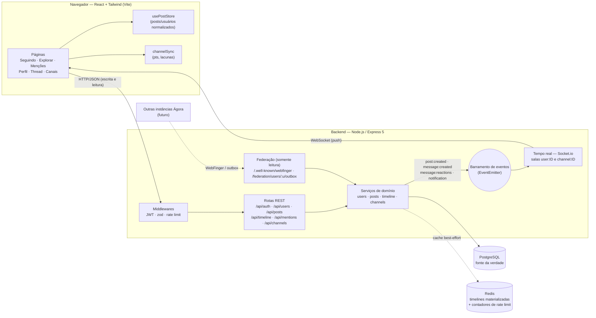
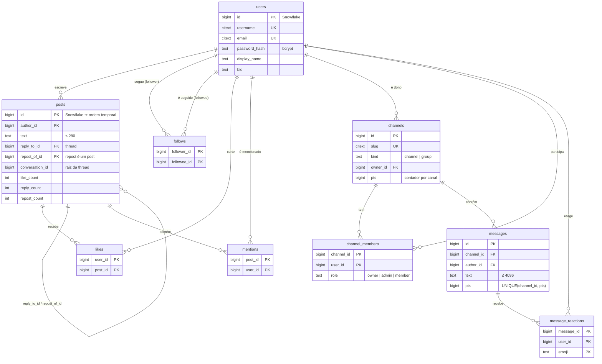
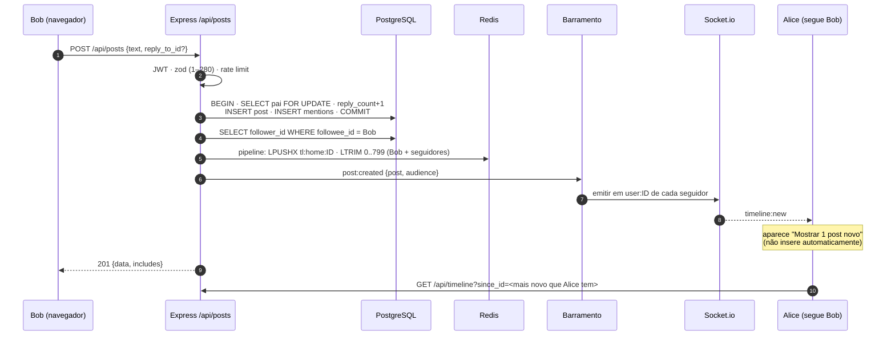
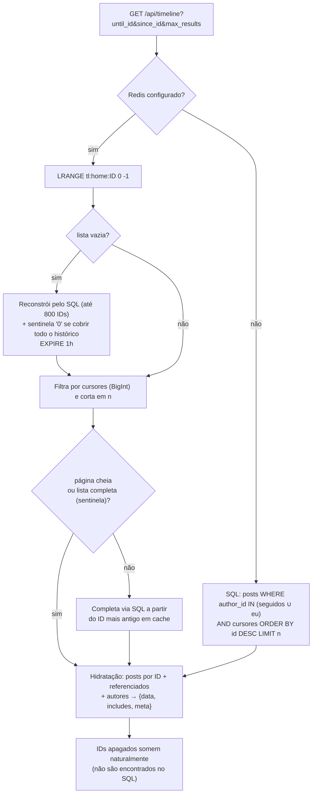
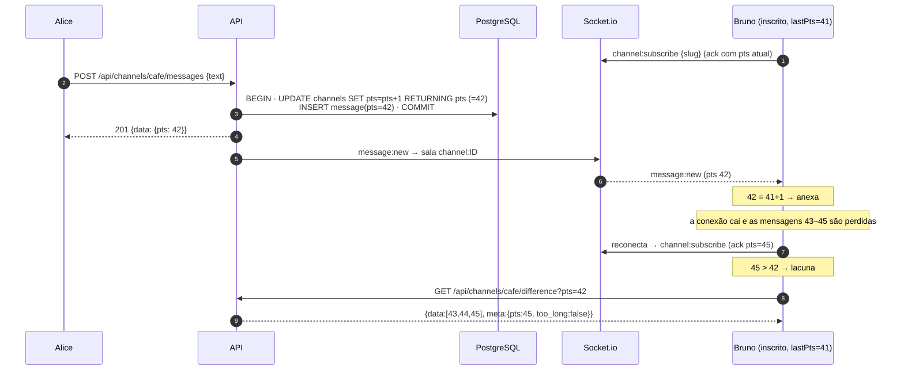
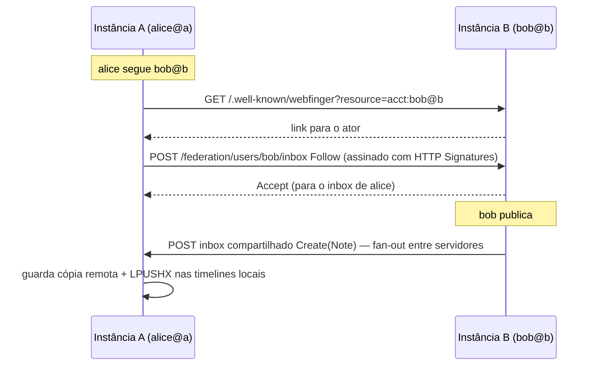

# Arquitetura do protótipo Ágora

Ágora é uma rede social **federável** de pesquisa: cada instância é independente (usuários, posts e canais próprios), identifica usuários como `usuario@instancia` e expõe uma camada de leitura compatível em espírito com WebFinger/ActivityPub. O foco é a clareza: um processo Node, um Postgres, um Redis opcional.

## 1. Componentes



**Princípios:**

1. **Um só caminho de escrita (REST).** O WebSocket só faz *push* do servidor para o cliente. Validação, autorização e rate limit ficam num lugar só.
2. **Postgres é a fonte da verdade, Redis é descartável.** Sem Redis, o sistema dá exatamente o mesmo resultado, só que mais devagar. Os testes rodam a mesma bateria nos dois modos.
3. **Serviços não conhecem o transporte.** Eles emitem eventos num barramento e o módulo Socket.io traduz para salas. Para escalar horizontalmente, troca-se o `EventEmitter` por Redis Pub/Sub (com `@socket.io/redis-adapter`).

### Mapa de código

```
backend/
  sql/schema.sql            tabelas, índices e restrições
  src/app.js                monta Express (rotas + tratamento de erros)
  src/server.js             HTTP + Socket.io + migração
  src/lib/                  snowflake, paginação, auth (JWT/bcrypt), rate limit, erros, menções
  src/services/             regras de negócio (users, posts, timeline, channels)
  src/routes/               camada HTTP fina: valida (zod) → chama serviço → serializa
  src/realtime/             barramento de eventos + Socket.io
  src/seed.js               dados fictícios
  test/                     unitários + integração (Postgres e Redis reais)
frontend/
  src/components/           Feed, PostCard, Composer, Layout, …
  src/pages/                Home, Explore, Mentions, Profile, Thread, Channels, Channel, Login, Register
  src/lib/                  api, socket, usePostStore, thread (árvore), channelSync (pts), time
```

## 2. Modelo de dados



Decisões importantes:

- **Snowflake gerado na aplicação** (`41 bits ms | 10 bits worker | 12 bits sequência`). Cada instância federada usa um `WORKER_ID` diferente e ninguém precisa de coordenação central. Ordenar por `id` é ordenar por tempo.
- **Contadores desnormalizados** (`like_count` etc.) atualizados na mesma transação da ação. A leitura do feed não faz `COUNT(*)`.
- **Repost como linha em `posts`**, com índice único parcial `(author_id, repost_of_id)`. Ele entra na timeline pelo mesmo caminho de um post comum.
- **`UNIQUE(channel_id, pts)`** garante, no próprio banco, que o `pts` nunca se repete.

## 3. Fluxos principais

### 3.1 Criar post (fan-out na escrita + push em tempo real)



`LPUSHX` só empurra se a lista **já existir**. Assim não se cria uma timeline parcial para quem não abriu o app recentemente: ela é reconstruída inteira na próxima leitura.

### 3.2 Ler a home timeline (cache, reconstrução e fallback)



Invalidação: seguir ou deixar de seguir faz `DEL tl:home:<seguidor>`. Apagar um post não mexe no cache, porque a hidratação descarta o ID ausente.

### 3.3 Mensagem em canal com detecção de lacuna (`pts`)



### 3.4 Autenticação

Cadastro com `username`, `email` e `password` (≥ 8, bcrypt com custo 10). Login por e-mail **ou** username, com a mesma mensagem de erro para "não existe" e "senha errada" (evita descobrir contas). O JWT (HS256, 7 dias) vai no header `Authorization: Bearer`, e o Socket.io valida o mesmo token no handshake.

## 4. API (resumo)

Formato de lista: `{ data: [...], includes: { users, posts }, meta: { result_count, newest_id, oldest_id, next_token } }`. Paginação: `since_id`, `until_id` (alias `max_id`) e `max_results` (1–100).

| Método | Rota | Auth | Descrição |
|---|---|---|---|
| POST | `/api/auth/register` | — | Cria a conta e devolve `{token, user}` |
| POST | `/api/auth/login` | — | `{login, password}` → `{token, user}` |
| GET | `/api/auth/me` | ✔ | Usuário atual |
| GET | `/api/timeline` | ✔ | Home "Seguindo" (cronológica reversa) |
| GET | `/api/mentions` | ✔ | Posts que mencionam o usuário |
| GET | `/api/posts` | opc. | Timeline pública da instância |
| POST | `/api/posts` | ✔ | `{text, reply_to_id?}` → post criado + autor |
| GET | `/api/posts/:id` | opc. | Post hidratado |
| GET | `/api/posts/:id/thread` | opc. | Conversa inteira (`meta.focal_id`) |
| DELETE | `/api/posts/:id` | ✔ | Apaga (só o autor) |
| POST/DELETE | `/api/posts/:id/like` | ✔ | Curtir / descurtir |
| POST/DELETE | `/api/posts/:id/repost` | ✔ | Repostar / desfazer |
| GET | `/api/users?q=` | — | Busca |
| GET | `/api/users/:username` | opc. | Perfil + métricas + relação |
| GET | `/api/users/:username/posts?exclude=replies,reposts` | opc. | Posts do usuário |
| GET | `/api/users/:username/followers` · `/following` | — | Listas |
| POST/DELETE | `/api/users/:username/follow` | ✔ | Seguir / deixar de seguir |
| GET/POST | `/api/channels` | ✔ | Listar / criar `{slug, title, kind}` |
| GET | `/api/channels/:slug` | ✔ | Detalhes + papel do usuário |
| POST | `/api/channels/:slug/members` | ✔ | Entrar |
| DELETE | `/api/channels/:slug/members/me` | ✔ | Sair |
| PUT | `/api/channels/:slug/members/:username/role` | ✔ dono | Promover/rebaixar admin |
| GET | `/api/channels/:slug/messages` | ✔ | Histórico paginado |
| GET | `/api/channels/:slug/difference?pts=N` | ✔ | Mensagens com pts > N |
| POST | `/api/channels/:slug/messages` | ✔ | Enviar (regras de `kind`/papel) |
| POST | `/api/channels/:slug/messages/:id/reactions` | ✔ | `{emoji}` |
| DELETE | `/api/channels/:slug/messages/:id/reactions/:emoji` | ✔ | Remover reação |
| GET | `/api/feed/interesses` | ✔ | Feed "Para você" do algoritmo aberto, com explicação por post |
| GET/PUT | `/api/feed/preferencias` | ✔ | Preferências do algoritmo e o que ele aprendeu |
| DELETE | `/api/feed/aprendizado` | ✔ | Apaga o aprendizado |
| POST | `/api/posts/:id/feedback` | ✔ | `{kind: "more" \| "less"}` |
| GET | `/api/feed/algoritmo` | — | Especificação pública do algoritmo |
| GET | `/.well-known/webfinger?resource=acct:u@dominio` | — | Descoberta federada |
| GET | `/federation/users/:u` · `/outbox` | — | Ator e últimos posts (ActivityStreams) |

**Eventos Socket.io (servidor → cliente):** `timeline:new`, `notification` (`mention` ou `reply`), `post:deleted`, `message:new`, `message:reactions`. **Cliente → servidor:** `channel:subscribe` (com ack `{ok, pts}`) e `channel:unsubscribe`.

## 5. Caminho para federação completa (não implementado)

O protótipo já tem as **pré-condições**: IDs sem coordenação central (Snowflake com worker por instância), handles `usuario@dominio`, WebFinger e um outbox público. Para federar de verdade faltaria:



Itens necessários: chaves por ator e assinatura HTTP; `inbox` com fila e reentrega com backoff; tabela de posts e atores remotos; política de moderação e bloqueio por domínio; deduplicação por URI. Em vez de ActivityPub, pode-se avaliar AT Protocol (repositórios assinados por usuário e *relays*) ou Nostr (eventos assinados e relays simples).

## 6. Escalabilidade: o que mudaria

| Gargalo | Hoje | Próximo passo |
|---|---|---|
| Fan-out de contas grandes | Push para todos os seguidores | Híbrido: acima de N seguidores, mesclar na leitura (como o X) |
| Barramento | `EventEmitter` em processo | Redis Pub/Sub ou NATS + `@socket.io/redis-adapter` |
| Fan-out síncrono | Dentro da requisição | Fila (BullMQ ou Kafka) com workers |
| Mídia | — | Upload direto ao objeto (S3/MinIO) com URL assinada, CDN e download em pedaços (como `upload.getFile`) |
| Busca | `ILIKE` | Postgres FTS ou OpenSearch |
| Contadores quentes | `UPDATE … +1` | Contadores no Redis com *flush* periódico |
