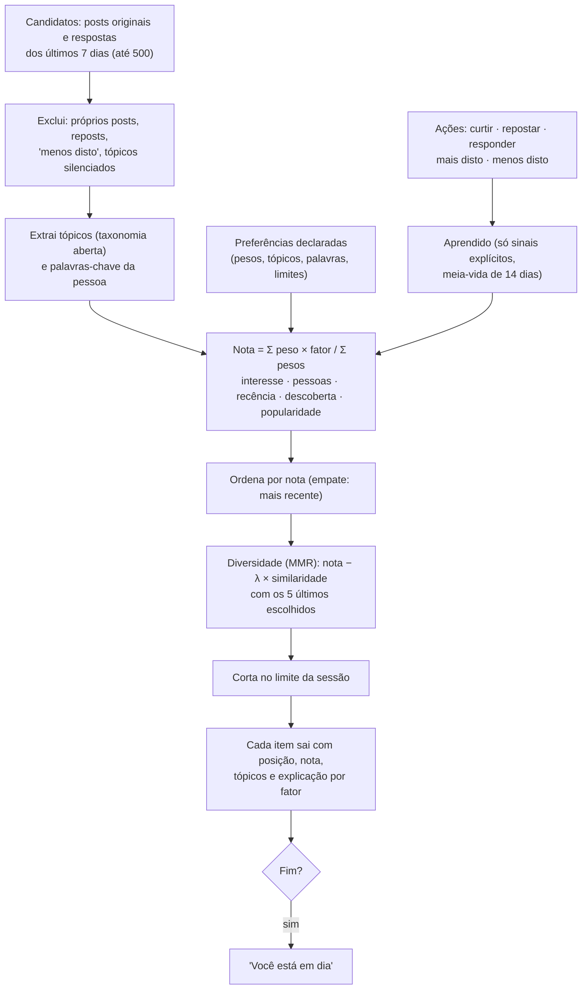
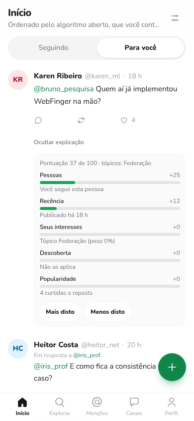
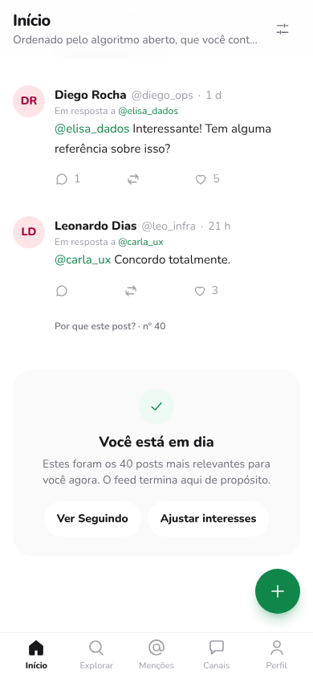

# Atenção, recompensa e o algoritmo aberto do Ágora

Este documento tem duas partes:

1. **Análise:** os mecanismos que o X/Twitter e o Telegram usam para capturar e manter a atenção, e o que a pesquisa diz sobre eles.
2. **Especificação:** o algoritmo **Interesses** (`interesses-v1`) do Ágora. Ele é aberto, explicável e controlado pelo usuário, e ordena o feed pelo que **a pessoa diz que quer ver**, não pelo que a mantém mais tempo na tela.

> **Sobre a palavra "dopamina".** "Gatilho de dopamina" é uma simplificação popular. O que a neurociência sustenta com mais solidez é: (a) neurônios dopaminérgicos sinalizam o **erro de previsão de recompensa**, ou seja, a diferença entre o esperado e o recebido (Schultz, Dayan e Montague, 1997); e (b) **recompensas intermitentes e imprevisíveis** sustentam um comportamento mais persistente que recompensas fixas (esquemas de razão variável, Ferster e Skinner, 1957). Estudos de imagem cerebral mostram ativação do sistema de recompensa (núcleo accumbens) ao receber curtidas, mas o fMRI mede fluxo sanguíneo, não dopamina diretamente. "Vício em redes sociais" também não é um diagnóstico formal do DSM-5. Usamos o termo "gatilho" no sentido de **mecanismo de design que explora aprendizado por recompensa**.

---

## Parte 1 — Análise dos mecanismos de atenção

### 1.1 O que a pesquisa mostra

| Achado | Referência |
|---|---|
| O sinal dopaminérgico codifica a *surpresa* da recompensa, não a recompensa em si. O imprevisível pesa mais | Schultz, Dayan e Montague (1997), *Science* |
| Adolescentes que viam fotos com **mais curtidas** tiveram maior ativação do núcleo accumbens e tendiam a curtir também | Sherman et al. (2016), *Psychological Science* |
| A resposta do núcleo accumbens a ganhos de reputação prediz a intensidade de uso do Facebook | Meshi et al. (2013), *Frontiers in Human Neuroscience* |
| O ritmo de postagem de milhões de usuários segue um modelo de **aprendizado por recompensa**, com curtidas funcionando como reforço | Lindström et al. (2021), *Nature Communications* |
| Cada palavra moral-emocional num post aumentou em ~20% a taxa de retweet | Brady et al. (2017), *PNAS* |
| Curtidas e respostas reforçam a expressão de indignação ao longo do tempo | Brady et al. (2021), *Science Advances* |
| A timeline ranqueada do Twitter amplificou conteúdo político de forma desigual em relação à cronológica | Huszár et al. (2022), *PNAS* |
| A ordenação por engajamento amplificou conteúdo hostil e emocional que os próprios usuários diziam **não preferir** | Milli et al. (2023) |

**Conclusão para o design:** quando a métrica otimizada é o engajamento (tempo, cliques, respostas), o sistema tende a premiar o que provoca, e não o que a pessoa valoriza quando pensa a respeito. A diferença entre o que **capta** a atenção e o que a pessoa **quer** ver é o centro deste trabalho.

### 1.2 Como o ranking do X pondera engajamento

O repositório `twitter/the-algorithm`, aberto em 2023, publicou os pesos do ranqueador principal do "Para você". Cada peso multiplica a **probabilidade prevista** de uma ação:

| Ação prevista | Peso |
|---|---|
| Curtir | 0,5 |
| Repostar | 1 |
| Responder | 13,5 |
| Abrir o perfil e interagir | 12 |
| Responder **e o autor responder de volta** | 75 |
| Feedback negativo ("não tenho interesse", silenciar…) | −74 |
| Denunciar | −369 |

Uma resposta prevista vale 27 curtidas, e uma conversa com o autor vale 150. Isso favorece posts que geram discussão, o que se combina com o efeito da indignação descrito acima. Esses são os valores publicados em 2023 e podem ter mudado desde então.

### 1.3 Inventário de mecanismos

| Mecanismo | Onde aparece | Efeito | Decisão no Ágora |
|---|---|---|---|
| **Rolagem infinita** | X (feed); Telegram (histórico de canais) | Remove os "pontos de parada" naturais; a sessão não tem fim | O "Para você" **tem fim**: limite por sessão (padrão 40) e a tela "Você está em dia". Não há carregamento automático: a próxima página exige um toque |
| **Puxar para atualizar / feed que muda a cada abertura** | X | Recompensa variável: cada atualização pode trazer algo melhor | Ranking **determinístico**: mesmos dados e preferências produzem a mesma ordem. Nada de aleatoriedade |
| **Contadores públicos** (curtidas, views, reposts) | X; Telegram (views e reações em canais) | Validação social e comparação; Sherman et al. (2016) | Popularidade com **peso zero** por padrão e opção "Esconder contadores" |
| **Ranking por engajamento previsto** | X ("Para você") | Favorece conflito e indignação (§1.1 e §1.2) | **Não prevê engajamento.** A nota vem de interesse declarado, pessoas, recência e descoberta |
| **Notificações e badges** | X ("fulano curtiu", "você pode gostar"); Telegram (contadores de não lidas) | Interrupções em horários imprevisíveis, o mesmo esquema de razão variável | Notificações só para o que é **dirigido a você** (menção e resposta). Nunca "alguém curtiu" ou "veja isto" |
| **Inserção automática de conteúdo novo** | Vários apps | Desloca a leitura e cria urgência | Aviso "Mostrar N posts novos" na aba Seguindo; a pessoa decide quando ver |
| **Presença e leitura** ("digitando…", "visto por último", confirmação de leitura) | Telegram | Pressão social para responder na hora | Não implementado |
| **Recomendação opaca** | X ("Para você"); Telegram ("canais similares", desde 2023) | A pessoa não sabe por que vê algo nem como mudar | **Cada post explica sua posição** com números, e a pessoa ajusta tudo |
| **Sequências e metas** ("streaks") | Apps em geral | Medo de perder a sequência (FOMO) | Sequências não existem. As missões diárias rendem um token interno de valor fixo (ver [`09-token-interno.md`](09-token-interno.md)), sem acúmulo por dias seguidos |
| **Autoplay de vídeo** | X | Consumo passivo contínuo | Só imagens, sem vídeo; se vídeo entrar, autoplay desligado por padrão |

O Telegram, vale notar, **não tem feed algorítmico**: canais e grupos são cronológicos. Os gatilhos dele estão na **mensageria** (contadores, notificações, presença), e não no ranqueamento.

---

## Parte 2 — Algoritmo Interesses (`interesses-v1`)

### 2.1 Princípios

1. **Declarado > inferido.** O que a pessoa escolhe nas preferências domina. O aprendido vale **no máximo metade** de um peso declarado.
2. **Só sinais explícitos ensinam.** Curtir, descurtir, repostar, responder, "Mais disto" e "Menos disto". **Nunca** tempo de tela, rolagem, visualizações, localização ou contatos. (Os minutos ativos medidos para a missão de tempo ficam fora do ranking, ver [`09-token-interno.md`](09-token-interno.md).)
3. **Popularidade não é qualidade.** Peso padrão zero. Quem quiser pode aumentar. A busca de posts segue a mesma ideia: mostra do mais recente ao mais antigo, sem dar vantagem a quem tem mais curtidas.
4. **Explicável item por item.** Cada post traz a conta que o colocou ali.
5. **Tem fim.** Limite por sessão e sem rolagem automática.
6. **Variedade obrigatória.** A reordenação MMR evita sequências do mesmo autor ou tema.
7. **Aberto.** O código (`shared/ranking/ranking.js`) é uma função pura, e a especificação está publicada em `GET /api/feed/algoritmo`.
8. **Reversível.** O aprendizado é visível, perde força com o tempo e pode ser apagado com um toque.

### 2.2 Pipeline



### 2.3 Fatores

Todos os fatores ficam em `[0, 1]`.

| Fator | Definição | Peso padrão |
|---|---|---|
| **interesse** | 1 se o texto contém uma palavra-chave da pessoa; senão, o maior **peso efetivo** entre os tópicos do post | 0,45 |
| **pessoas** | 1 se a pessoa segue o autor; senão `0,6 × afinidade aprendida com o autor` | 0,25 |
| **recencia** | `0,5 ^ (idade_em_horas / meia_vida)`, com meia-vida configurável (padrão 24 h) | 0,20 |
| **descoberta** | 1 se o autor é novo (não seguido, sem afinidade) **e** o interesse é ≥ 0,3; senão 0 | 0,10 |
| **popularidade** | `ln(1 + curtidas + reposts) / ln(51)`, limitado a 1 | **0** |

**Nota:** `score = Σ (peso_f × valor_f) / Σ peso_f`, sempre entre 0 e 1. A explicação devolve a contribuição de cada fator, e a soma das contribuições é igual à nota.

**Peso efetivo de um tópico:** `clamp(declarado + 0,5 × aprendido, 0, 1)`.

### 2.4 Aprendizado

```
aprendido_novo = clamp( aprendido_atual × 0,5^(dias_desde_a_última_atualização / 14) + Δsinal , −1, 1 )
```

| Sinal | Δ |
|---|---|
| curtir | +0,15 |
| descurtir | −0,15 |
| repostar | +0,25 |
| responder | +0,30 |
| mais disto | +0,30 |
| menos disto | −0,50 (e o post some do feed) |

O sinal atualiza a afinidade com **cada tópico do post** e com **o autor**. Interagir com o próprio post não ensina nada.

### 2.5 Diversidade (Maximal Marginal Relevance)

A cada passo, o algoritmo escolhe o candidato com maior `nota − λ × max(similaridade com os 5 últimos escolhidos)`. A similaridade vale 1 para o mesmo autor; para autores diferentes, é o índice de Jaccard entre os tópicos. O λ é o controle "Variedade" (padrão 0,5).

### 2.6 Exemplo real de explicação

Um post de alguém que a pessoa segue, publicado há menos de 1 hora, sobre "Postgres e cache Redis na aula", para quem declarou *Bancos de dados* com peso 90%:

| Fator | Valor | Peso (normalizado) | Contribuição | Detalhe |
|---|---|---|---|---|
| interesse | 0,90 | 0,45 | 0,405 | Tópico Bancos de dados (peso 90%) |
| pessoas | 1,00 | 0,25 | 0,250 | Você segue esta pessoa |
| recencia | 1,00 | 0,20 | 0,200 | Publicado há menos de 1 h |
| descoberta | 0 | 0,10 | 0 | Não se aplica |
| popularidade | 0,35 | 0 | 0 | 3 curtidas e reposts |
| **Nota** | | | **0,855** | |

### 2.7 Controles do usuário (tela "Meu algoritmo")

- Peso de cada fator, com a fração da nota que ele representa.
- Peso de cada tópico (0–100%) e silenciar tópico.
- Linhas de interesse livres (até 20 palavras-chave).
- Posts por sessão, variedade e por quanto tempo um post continua "novo".
- Esconder contadores.
- Ver tudo o que foi aprendido (tópicos e pessoas, de −100 a +100) e apagar.
- Link para a especificação completa em JSON.

Quando a pessoa ainda não escolheu nada, o feed avisa que está "quase em ordem de chegada" e convida a escolher tópicos, em vez de inventar um perfil silenciosamente.

| "Por que este post?" | Fim da sessão |
|---|---|
|  |  |

### 2.8 API

| Método | Rota | Descrição |
|---|---|---|
| GET | `/api/feed/interesses?max_results=&next_token=` | Feed ranqueado. Cada item traz `ranking { position, score, topics, keywords, reasons[] }`; `meta` traz `caught_up`, `session`, `personalized`, `hide_metrics` |
| GET | `/api/feed/preferencias` | Preferências, aprendizado (com decaimento), tópicos e fatores |
| PUT | `/api/feed/preferencias` | Atualização parcial validada; campos desconhecidos são recusados |
| DELETE | `/api/feed/aprendizado` | Apaga afinidades e posts escondidos |
| POST | `/api/posts/:id/feedback` | `{ kind: "more" \| "less" }` |
| GET | `/api/feed/algoritmo` | Especificação pública (sem login) |
| GET | `/api/feed/candidatos` | Candidatos para o ranking no aparelho (+ `meta.following`) |
| PUT | `/api/feed/modo` | `{ mode: "device" }` (contas antigas): o servidor apaga a cópia que tinha do algoritmo |

### 2.9 Testes

- `backend/test/unit/ranking.test.js`: nota em [0,1] igual à soma das contribuições; popularidade sem efeito por padrão; meia-vida da recência; silenciamento; palavras-chave; regra da descoberta; declarado dominando o aprendido; decaimento; MMR quebrando sequências; limite da sessão.
- `backend/test/feed.test.js` e `device-mode.test.js`: o servidor não calcula nem guarda o algoritmo; candidatos iguais para qualquer preferência; ordenação no aparelho com preferências e silenciamento; importação única de contas antigas.
- `frontend/src/lib/deviceAlgo.test.js` e `rankingMode.test.js`: aprendizado, "menos disto" e reset no aparelho; carga do algoritmo ao voltar ao app.
- `frontend`: painel "Por que este post?", "Menos disto" e cursor e fim do feed de interesses.

### 2.10 Onde o algoritmo fica: só no aparelho de cada pessoa

**Decisão do projeto:** o algoritmo de cada pessoa (preferências, aprendizado e "menos disto") fica **exclusivamente no aparelho dela**. Sempre que a pessoa volta ao app, ele é carregado do aparelho. A instância não guarda nem calcula o feed "Para você".

| | Como funciona |
|---|---|
| Quem faz a conta | O navegador, com o arquivo aberto `shared/ranking/ranking.js` |
| O que o servidor envia | Os candidatos (`GET /api/feed/candidatos`): posts originais dos últimos 7 dias, até 500, e a lista de quem a pessoa segue. São os mesmos para qualquer preferência |
| Onde ficam preferências, aprendizado e "menos disto" | Só no navegador (`localStorage`, chave `agora.algo.v1.<id>`) |
| O que o servidor guarda | Só o que não é do algoritmo: missões ligadas ou não e contagem de tempo |
| Sair da conta | O algoritmo continua no aparelho e volta quando a pessoa entrar de novo |
| Outro aparelho | Começa do zero e aprende lá |

```mermaid
sequenceDiagram
  participant N as Navegador
  participant S as Servidor
  Note over N: ao voltar ao app, carrega o algoritmo do aparelho
  N->>S: GET /api/feed/preferencias (conta antiga ainda com dados no servidor?)
  S-->>N: ranking_mode "server" + o que o servidor tinha
  Note over N: se o aparelho não tem algoritmo, importa; se tem, o do aparelho vale
  N->>S: PUT /api/feed/modo { mode: "device" }
  S-->>N: apaga feed_settings (algoritmo), learned_*, hidden_posts
  N->>S: GET /api/feed/candidatos
  Note over N: rank() com as preferências locais → páginas, explicações, fim de sessão
  N->>S: POST /api/posts/:id/like (ação pública, como sempre)
  Note over N: aprende só no aparelho
```

**Garantias, cobertas por testes:**

- **O servidor não guarda nada do algoritmo.** `PUT /api/feed/preferencias` só aceita `missions_enabled` e `count_time`; curtir, repostar, responder e "menos disto" não geram `learned_*` nem `hidden_posts` (`stored: false`).
- **O servidor não calcula o feed.** `GET /api/feed/interesses` responde 410 e aponta para `/api/feed/candidatos`. `PUT /api/feed/modo` só aceita `device`.
- **Os candidatos não dependem das preferências.** Mudar o algoritmo não altera a resposta de `/api/feed/candidatos`.
- **Contas antigas:** na primeira volta ao app, se o aparelho ainda não tem um algoritmo, o app importa o que o servidor tinha. Em seguida o servidor apaga a cópia. Se o aparelho já tem um algoritmo, ele vale e nada é sobrescrito.
- **Sem armazenamento disponível** (modo privado), o algoritmo funciona só em memória durante a visita. Dados apagados ou corrompidos fazem o algoritmo recomeçar do zero, sem quebrar o feed.

**Limites:** a lista de quem a pessoa segue e as curtidas continuam visíveis para quem tem conta, e o servidor vê quais posts foram abertos ou curtidos. O que fica só no aparelho são as **preferências e o aprendizado**, não a atividade. Não há sincronização entre aparelhos, por decisão do projeto.

### 2.11 Limites e próximos passos

- **Taxonomia simples**, em português e por palavra-chave. Há falsos positivos e negativos. Próximo passo: permitir que cada instância edite a taxonomia ou usar embeddings **locais** (sem enviar texto para terceiros), mantendo a explicação por tópico.
- **Partida a frio:** sem preferências, o feed se aproxima do cronológico, de propósito, e avisa isso.
- **Sem avaliação com pessoas reais.** A métrica sugerida não é tempo de uso, e sim satisfação declarada ("este post valeu seu tempo?") e tempo de que a pessoa se arrependeu, comparando com o feed cronológico.
- **Ideias relacionadas:** o Bluesky permite escolher entre algoritmos de feed de terceiros, e o Mastodon é cronológico. O Digital Services Act europeu (art. 38) exige que plataformas muito grandes ofereçam ao menos uma opção de recomendação **sem perfilamento**: no Ágora, a aba "Seguindo" cumpre esse papel.
