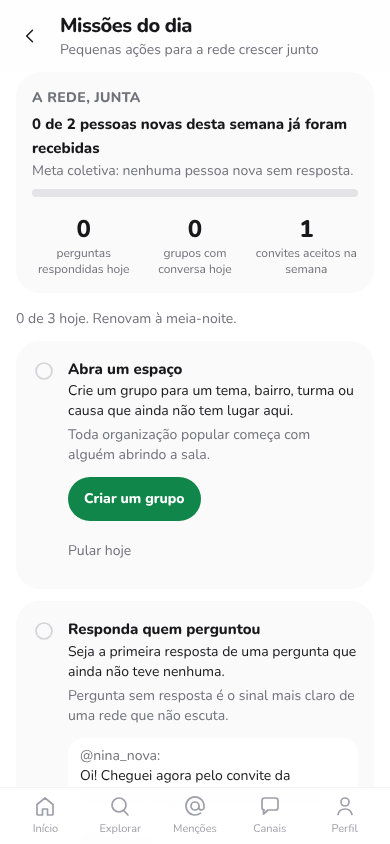
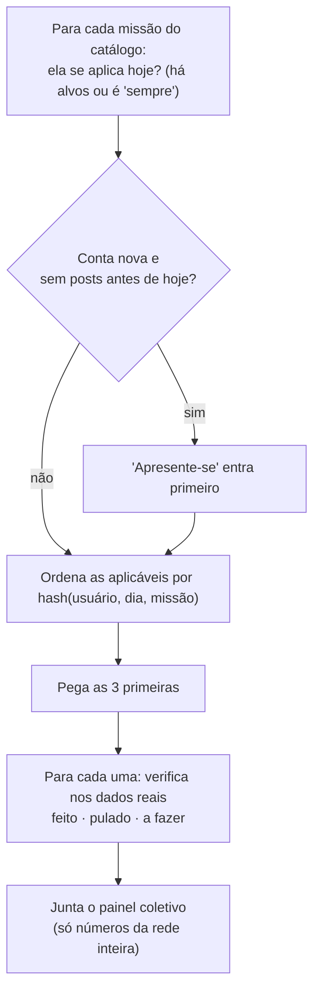

# Missões diárias de organização popular

As missões fazem a rede crescer **de forma orgânica**: por acolhimento, conversa e confiança entre pessoas, e não por anúncios, notificações insistentes ou recompensas. Todo dia, cada pessoa recebe até três sugestões de ações pequenas e concretas que beneficiam **outra pessoa ou a rede inteira**: receber quem chegou, responder quem perguntou, abrir um espaço para um tema ou bairro, trazer alguém de confiança.

## 1. Por que não é gamificação

Missões diárias costumam vir com pontos, sequências ("streaks"), níveis e rankings, justamente os mecanismos de recompensa variável analisados em [`07-atencao-e-algoritmo-aberto.md`](07-atencao-e-algoritmo-aberto.md). Aqui eles foram deixados de fora de propósito:

| Mecanismo comum | Problema | No Ágora |
|---|---|---|
| Pontos e níveis | Recompensas externas esperadas reduzem a motivação intrínseca (efeito de superjustificação: meta-análise de Deci, Koestner e Ryan, 1999) | **Não existem.** A missão concluída mostra "Feito. Obrigado por cuidar da rede." |
| Sequências de dias | Exploram a aversão à perda: a pessoa volta para não "quebrar" a sequência, não porque quer | **Não existem.** Nada acumula de um dia para o outro |
| Ranking individual | Comparação social e competição entre membros da mesma comunidade | **Só números coletivos**, nunca de pessoas |
| Notificações cobrando | Interrupções e culpa | **Nenhuma.** As missões só aparecem quando a pessoa abre o app |
| Metas fáceis de "farmar" (ex.: "poste 5 vezes") | A métrica vira o objetivo (lei de Goodhart) e gera spam | Cada missão exige **qualidade verificável**: ser a *primeira* resposta, seguir alguém *fora do seu círculo*, repostar quem tem *menos de 5 seguidores* |

**Base em pesquisa sobre comunidades.** O acolhimento das primeiras contribuições de quem chega é decisivo para uma comunidade continuar crescendo. Na Wikipédia, a rejeição frequente de novatos ajudou a explicar o declínio no número de editores (Halfaker et al., 2013). O manual de Kraut e Resnick, *Building Successful Online Communities* (2012), reúne princípios de design para socializar recém-chegados e incentivar contribuições. Por isso a **meta coletiva** do Ágora é "nenhuma pessoa nova sem resposta".

## 2. Princípios

1. Sem pontos, sem sequências e sem ranking individual.
2. Cada missão beneficia outra pessoa ou a rede inteira.
3. A conclusão é **verificada pelo que aconteceu de fato** (posts, follows, mensagens, convites), nunca por autodeclaração.
4. Pular não tem custo, e nenhuma notificação cobra missões.
5. No máximo três por dia. Elas renovam à meia-noite no fuso da instância (padrão `America/Sao_Paulo`, configurável em `MISSION_TZ`).
6. A pessoa pode esconder as missões quando quiser, na tela "Meu algoritmo" ou na própria página de missões.

## 3. Catálogo

| Missão | Quando aparece | Verificação (no dia) | Por quê |
|---|---|---|---|
| **Apresente-se** | Conta com menos de 7 dias e que ainda não postou antes de hoje (sempre primeiro) | Um post original seu | Quem se apresenta recebe boas-vindas e encontra sua turma |
| **Dê boas-vindas** | Há alguém que entrou nos últimos 7 dias e com quem você nunca interagiu | Você respondeu ou mencionou uma pessoa nova | A primeira resposta decide se alguém fica |
| **Responda quem perguntou** | Há posts com "?" dos últimos 3 dias sem nenhuma resposta | Sua resposta foi a **primeira** a uma pergunta de outra pessoa | Pergunta sem resposta é sinal de rede que não escuta |
| **Construa uma ponte** | Há quem poste e não seja seguido por ninguém que você segue | Você seguiu alguém que nenhuma pessoa do seu círculo segue | Conexões fora da bolha evitam câmaras de eco |
| **Amplifique uma voz pequena** | Há posts recentes de quem tem menos de 5 seguidores | Você repostou alguém com menos de 5 seguidores | Distribuir atenção em vez de concentrá-la |
| **Participe de uma conversa coletiva** | Existem grupos | Você mandou mensagem num **grupo** (canais de broadcast não contam) | Grupos são onde a rede se organiza |
| **Abra um espaço** | Sempre | Você criou um **grupo** hoje | Toda organização popular começa com alguém abrindo a sala |
| **Traga alguém de confiança** | Sempre | Um convite seu foi usado hoje | Crescer por confiança, de pessoa para pessoa |

Cada missão pendente vem com **alvos concretos** (até 3): as pessoas novas, as perguntas sem resposta, os grupos ou as vozes pequenas. Assim a pessoa não precisa procurar.

### Seleção

A ordenação usa um hash estável (FNV-1a), então a mesma pessoa no mesmo dia vê sempre as mesmas missões. Recarregar a página não "sorteia" de novo, o que evita o efeito caça-níquel.

## 4. Painel coletivo: "A rede, junta"

Mostra apenas números agregados da instância:

- **Meta coletiva:** quantas das pessoas que entraram nesta semana já receberam pelo menos uma resposta ou menção de outra pessoa ("3 de 4 pessoas novas já foram recebidas").
- Perguntas que receberam a primeira resposta hoje.
- Grupos com conversa hoje.
- Convites aceitos na semana.

## 5. Convites

- Cada pessoa gera convites de uso único (código de 8 caracteres sem símbolos ambíguos), com no máximo 10 abertos ao mesmo tempo e 20 gerados por dia.
- O link `/cadastro?convite=CODIGO` abre o cadastro com a mensagem "Você foi convidada(o)".
- Ao entrar por convite, a pessoa nova passa a **seguir quem convidou**, para o feed dela não começar vazio. Tudo acontece numa única transação: se o convite for inválido ou já usado, nenhuma conta é criada.
- Não há recompensa por convite, importação de contatos nem envio automático de mensagens. Quem convida escolhe a quem mandar o link.
- O cadastro sem convite continua aberto.

## 6. API

| Método | Rota | Descrição |
|---|---|---|
| GET | `/api/missoes` | `{ enabled, day, timezone, summary, missions[], collective, principles }` |
| POST | `/api/missoes/:id/pular` | Pula a missão hoje |
| GET | `/api/convites` | Seus convites e quem os aceitou |
| POST | `/api/convites` | Gera um convite: `{ code, path }` |
| POST | `/api/auth/register` | Aceita `invite_code` opcional |
| PUT | `/api/feed/preferencias` | `{ missions_enabled: false }` esconde as missões |

Novas tabelas: `mission_skips` e `invites`. Não existe tabela de pontos ou progresso: o status é sempre calculado a partir dos dados reais.

## 7. Testes

- `backend/test/unit/missions.test.js`: seleção determinística, variação entre dias e pessoas, no máximo 3, só missões aplicáveis, "apresentar" só para contas novas, e um catálogo sem linguagem de pontos.
- `backend/test/missions.test.js`: regras de verificação de **todas** as missões com ações reais, incluindo os casos que **não** contam (segunda resposta a uma pergunta, ponte dentro do próprio círculo, canal de broadcast); pular; desligar; painel coletivo; convites (uso único, transação, seguir quem convidou, limites).
- `frontend`: página de missões (meta coletiva, alvos, pular, gerar convite, missões escondidas) e cadastro com `?convite=`.

## 8. Limites e próximos passos

- "Pergunta" é detectada pelo caractere `?`, uma heurística simples.
- O fuso é um só por instância. O ideal é usar o fuso de cada pessoa.
- Ideias: missões **locais** (por bairro, cidade ou causa), missões **propostas pela própria comunidade** com moderação, e um mural de eventos e assembleias ligado aos grupos.
