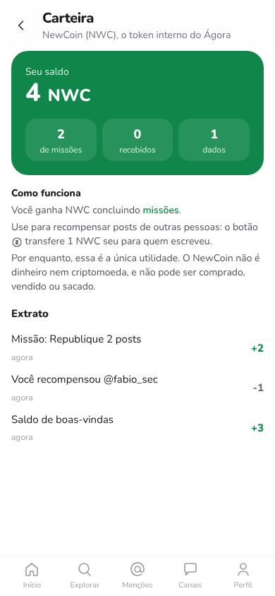

# Token interno: NewCoin (NWC)

O NewCoin é o token interno do Ágora. Ele serve para **as pessoas se recompensarem entre si**, como um "like" que carrega valor dentro da rede, e é **ganho concluindo missões** dentro do app. Por decisão de projeto, a **utilidade é nula no início**: recompensar posts é a única coisa que se faz com ele.

O nome e o símbolo são configuráveis (`TOKEN_NAME`, `TOKEN_SYMBOL`). O padrão é "NewCoin" (NWC).

| Missões com recompensa | Carteira |
|---|---|
|  |  |

## 1. Regras

| Regra | Como está implementado |
|---|---|
| **Emissão só por missões** | Cada missão concluída credita uma quantia fixa (1 a 4 NWC), **uma vez por pessoa, por missão, por dia**. A unicidade é garantida pelo banco (`mission_rewards`, chave `user_id + day + mission`) |
| **Saldo inicial** | 3 NWC na criação da carteira, para a pessoa poder recompensar desde o primeiro dia |
| **Recompensar = transferir** | O botão de moeda no post move **1 NWC** de quem recompensa para o autor. Não cria token novo |
| **Como um like** | Uma recompensa por post por pessoa, sem desfazer. Recompensar um repost paga o autor do original |
| **Limites** | Não dá para recompensar o próprio post; são no máximo 20 recompensas por dia; com saldo zero, a recompensa é recusada (HTTP 409) e nada é registrado |
| **Contabilidade** | Extrato imutável (`token_ledger`) e saldo com `CHECK (balance >= 0)`. Os testes verificam que **saldo = soma do extrato** em todas as carteiras após cada operação |
| **Utilidade** | Nenhuma além de recompensar. Não há loja, compra, venda, saque, conversão nem transferência para fora do app |

### Por que a recompensa transfere em vez de criar

Se cada recompensa criasse token novo, duas contas poderiam se recompensar em círculo e inflar o saldo sem limite. Como a recompensa só transfere, **o total em circulação só cresce por missões**, que são limitadas por dia e verificadas pelas ações reais. Esse comportamento é testado: duas contas que se recompensam mutuamente mantêm o mesmo total.

### Quanto se pode ganhar por dia

São 4 missões por dia (2 de engajamento e 2 de rede), com recompensas de 1 a 4 NWC. O teto teórico diário (`MAX_DAILY_REWARD`) é de **13 NWC**: as duas maiores recompensas de engajamento (3 + 2) mais as duas maiores de rede (4 + 4). Na prática, o ganho fica entre 6 e 10 NWC num dia em que a pessoa faz todas as missões.

## 2. Missões que rendem token

Todas são feitas **dentro do app e online**. Nenhuma pede algo físico, deslocamento, compra, foto pessoal ou ação fora da rede. Um teste do catálogo recusa descrições com termos como "visite", "compre" ou "encontre pessoalmente".

**Engajamento:** metas numéricas, com regra de qualidade e barra de progresso.

| Missão | Meta | Regra de qualidade | NWC |
|---|---|---|---|
| Curta 5 posts | 5 curtidas no dia | De **pelo menos 3 pessoas diferentes**; curtir os próprios posts não conta | 2 |
| Republique 2 posts | 2 reposts | Só posts de outras pessoas | 2 |
| Comente 3 posts | 3 respostas | Em posts de outras pessoas, com **pelo menos 15 caracteres** | 3 |
| Recompense alguém | 1 recompensa | Para outra pessoa (gasta 1 NWC e devolve 1, então incentiva a circulação) | 1 |
| Fique 10 minutos ativo | 10 minutos | Só conta com a aba visível **e** interação nos últimos 2 min; no máximo 1 min a cada 55 s; teto de 120 min/dia | 1 |

**Rede:** organização popular, ver [`08-missoes-organizacao-popular.md`](08-missoes-organizacao-popular.md).

| Missão | NWC |
|---|---|
| Apresente-se (contas novas) | 2 |
| Dê boas-vindas | 3 |
| Responda quem perguntou (primeira resposta) | 3 |
| Construa uma ponte | 2 |
| Amplifique uma voz pequena | 2 |
| Participe de uma conversa coletiva | 2 |
| Abra um espaço (criar grupo) | 4 |
| Traga alguém de confiança (convite aceito) | 4 |

**O crédito é automático:** ao abrir as missões, o sistema verifica o que foi feito e credita o que ainda não foi pago. Não existe botão de "resgatar", o que evita mais um gatilho de recompensa.

## 3. Tempo no app

A missão de tempo foi pedida explicitamente, mas medir tempo de tela é justamente um dos mecanismos que [`07-atencao-e-algoritmo-aberto.md`](07-atencao-e-algoritmo-aberto.md) analisa como captura de atenção. Por isso a medição é limitada:

- O cliente envia **um sinal por minuto**, só com a aba visível e alguma interação (toque, tecla ou rolagem) nos últimos 2 minutos.
- O servidor guarda **apenas o total de minutos do dia** (`activity_days`), sem registrar o que foi visto.
- Teto de 120 minutos por dia, e a missão pede só 10.
- **Nunca entra no ranking do feed.** O algoritmo "Para você" continua sem usar tempo de tela.
- A pessoa pode desligar em **Meu algoritmo → Contar meu tempo no app**. Desligado, o servidor ignora os sinais e a missão de tempo deixa de ser sorteada.

## 4. API

| Método | Rota | Descrição |
|---|---|---|
| GET | `/api/token` | Regras públicas (nome, símbolo, utilidade, o que o token **não** é) |
| GET | `/api/carteira` | Saldo, totais (de missões, recebidos, dados) e extrato |
| POST | `/api/posts/:id/recompensa` | Recompensa o autor com 1 NWC e devolve o post atualizado (`public_metrics.tip_count`, `viewer.tipped`) |
| POST | `/api/atividade` | Sinal de minuto ativo: `{ counted, minutes }` |
| GET | `/api/missoes` | Agora inclui `token { balance, earned_today, earned_now }`, além de `reward`, `family` e `progress` em cada missão |

Novas tabelas: `token_balances`, `token_ledger`, `mission_rewards`, `tips` e `activity_days`, mais a coluna `posts.tip_count`.

## 5. Cuidados e próximos passos

- **Utilidade futura.** Qualquer uso novo (destacar um grupo, votar em propostas da comunidade, etc.) deve ser decidido de forma aberta. Se algum dia o token puder ser convertido em dinheiro ou trocado fora do app, isso exige análise jurídica antes (no Brasil, por exemplo, normas da CVM e do Banco Central sobre ativos virtuais), além de uma revisão de segurança.
- **Abuso.** As regras de qualidade reduzem o spam, mas contas falsas ainda podem cumprir missões. Antes de dar qualquer utilidade real ao token, é preciso verificação de contas ou limites por instância.
- **Equilíbrio.** Missões de engajamento numéricas têm mais risco de virar "obrigação" do que as missões de rede. Vale medir se as pessoas sentem que as missões ajudam ou pressionam, e ajustar as metas.
