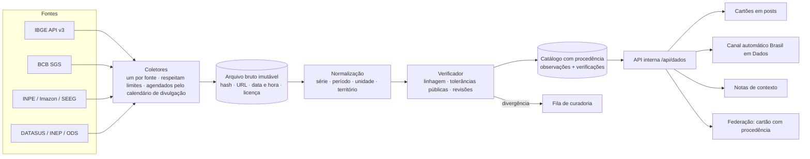

# Informação oficial e aberta sobre o desenvolvimento brasileiro, com verificação tripla

**Data:** 28/10/2026 · **Tipo:** análise e proposta (nada implementado ainda) · **Foco:** integração com o app social

## 1. Em linguagem simples

**A ideia.** Numa rede social, números circulam soltos: "o desemprego dobrou", "o desmatamento caiu pela metade". A proposta é que qualquer pessoa possa anexar a um post um **cartão de dado**. O cartão mostra o valor de um indicador oficial, a data, de onde veio e **quantas fontes diferentes confirmam aquele número**.

**O que é "verificação tripla" aqui.** Um dado só recebe o selo mais alto quando passa por três conferências:

1. **A fonte de origem:** quem produz o dado (IBGE, Banco Central, INPE, Ministério da Saúde…). É a referência.
2. **Uma fonte independente:** outra instituição que mede a mesma coisa por outro caminho (um instituto de pesquisa, uma ONG, um organismo internacional com método próprio). Republicar o número do IBGE não conta como fonte independente.
3. **A conferência técnica:** o valor foi copiado sem erro, a unidade e o período estão certos, não houve revisão posterior, e o número é coerente com indicadores vizinhos.

**Fontes diversas.** As três conferências devem vir de **tipos diferentes de instituição** (órgão federal, autarquia técnica, academia, sociedade civil, organismo internacional). Assim, a confirmação não depende de um único governo ou grupo.

**Honestidade sobre os limites.** Muitos dados oficiais têm um único produtor no país. Só o IBGE faz o Censo; só o Copom decide a Selic. Nesses casos o app **não finge** ter três fontes: mostra "fonte única, conferida" e explica por quê. E quando as fontes discordam, o app **mostra as duas** e a diferença de método, em vez de escolher uma.

**O que o app não faz.** Não decide se a opinião de alguém é verdadeira ou falsa, não rotula posts alheios sozinho e não dá mais alcance a quem cita dado oficial. Ele oferece o dado e a fonte; a interpretação é das pessoas.

## 2. Por que isso combina com o Ágora

- **Mesmos princípios do feed "Para você":** é aberto, explicável e controlado por quem usa (docs/07). O cartão de dado diz de onde veio cada número, como o "Por que este post?" diz por que cada post aparece.
- **A moderação já tem base** (docs/11 e docs/12): regras públicas, decisões que citam a regra, recurso. Desinformação sobre dados públicos se trata **com contexto, não com remoção**. Remover fica para documento oficial forjado ou para quem se passa por órgão público, casos que a regra 3 ("Sem golpes nem se passar por outra pessoa") já cobre.
- **Missões de organização popular** (docs/08): discutir o próprio bairro e o país com números confiáveis é organização popular.
- **Federação:** um cartão carrega a própria procedência. Outra instância pode conferir o mesmo dado sem confiar no Ágora.

## 3. Definição operacional da verificação tripla

### 3.1 As três conferências

| Conferência | Pergunta | Como o sistema responde |
|---|---|---|
| **A. Origem** | Quem produz o dado e onde está publicado? | Coleta direta da API ou arquivo do produtor, com o original guardado (hash, data e hora, URL) |
| **B. Independência** | Outra instituição chega a um número compatível? | Compara com uma fonte de **outra linhagem** (outro produtor ou outro método), dentro de uma tolerância definida por indicador |
| **C. Consistência** | O número está certo no detalhe? | Confere transcrição (republicadores devem bater exatamente), unidade, período, revisões do produtor e coerência com indicadores relacionados |

### 3.2 Independência não é quantidade

Cada fonte é registrada com a sua **linhagem**: de onde ela tira o número. Há três tipos de relação:

- **Republicação** (Banco Central republicando o IPCA, Ipeadata, Banco Mundial republicando o PIB do IBGE). Serve só para a conferência C (transcrição). **Nunca conta como fonte independente.**
- **Mesma base, cálculo independente** (FGV Social e Banco Mundial calculando pobreza a partir da PNAD). Vale como meia independência: confirma o cálculo, mas não a coleta.
- **Método distinto** (INPE/PRODES e Imazon/SAD medindo desmatamento por satélite; DATASUS e estimativa demográfica do IBGE para mortalidade infantil). É **independência plena**.

### 3.3 Selos que o cartão pode mostrar

| Selo | Quando | O que o cartão diz |
|---|---|---|
| **Confirmado por 3 conferências** | A + B (método distinto ou cálculo independente) + C, sem divergência | "Origem: IBGE. Confirmado por Imazon (outro método). Conferido em 28/10." |
| **Fonte única, conferida** | Só existe um produtor (Censo, Selic, IDEB); A + C passam | "Só o IBGE produz este dado. Conferimos a cópia e a data." |
| **Em divergência** | B discorda de A além da tolerância | Mostra os dois valores, a diferença e o porquê (método, período, cobertura) |
| **Revisado** | O produtor mudou o número depois que o post foi feito | "Valor no post: 2,9 %. Valor revisado pelo IBGE: 3,1 %." |
| **Desatualizado** | Saiu dado mais novo | Mostra o valor do post e o mais recente |
| **Não verificável** | A fonte saiu do ar ou mudou de formato | Mantém o último original guardado, com aviso |

As tolerâncias são públicas e definidas por indicador: 0 para transcrição, uma faixa em pontos percentuais para métodos distintos. Elas ficam num arquivo aberto, como os pesos do algoritmo.

## 4. Catálogo de fontes (situação atual de acesso)

Levantamento feito em 28/10/2026 com pesquisa na web. Os itens "a confirmar" precisam ser checados na documentação oficial antes da implementação.

| Fonte | Produtor (tipo) | Acesso por máquina | Observações |
|---|---|---|---|
| **IBGE, API de agregados v3** (SIDRA) | IBGE (autarquia federal de estatística) | `servicodados.ibge.gov.br/api/v3/agregados`, sem chave | Cada tabela tem um ID estável. A API antiga `apisidra.ibge.gov.br` continua ativa. Limite de linhas por pedido a confirmar (as fontes citam 20 mil e 100 mil). |
| **Banco Central, SGS** | BCB (autarquia com autonomia) | `api.bcb.gov.br/dados/serie/bcdata.sgs.{código}/dados`, sem chave | Janela máxima de 10 anos por consulta. Desde 26/03/2025 o uso de filtros é obrigatório. `/ultimos/N` vai até 20 valores. |
| **Ipeadata** | Ipea (fundação pública de pesquisa) | API OData; o pacote oficial `ipeadatar` mostra as chamadas | Agrega muitas séries de terceiros: tratar como **republicador** quando a série vem de outro órgão. Caminhos exatos da API a confirmar. |
| **Portal da Transparência** | CGU | API com chave pessoal (cadastro; o fluxo pode exigir conta gov.br com verificação em duas etapas) | Limites citados: 400 req/min (700 de madrugada; 180 nas APIs restritas). **Contém dados pessoais** (servidores, beneficiários): usar só agregados. |
| **dados.gov.br** | Governo federal (catálogo CKAN) | API com token gerado após login gov.br (CPF) | Catálogo, não produtor: serve para **achar** bases e licenças. |
| **INPE, TerraBrasilis** (PRODES, DETER) | INPE (instituto federal de pesquisa) | Arquivos e serviços geográficos públicos | O PRODES é a taxa oficial anual; o DETER é alerta quase diário, com limiar de área e afetado por nuvens. |
| **Imazon, SAD** | ONG de pesquisa | Relatórios mensais e dados para baixar | **Método distinto** do INPE: fonte independente para desmatamento. |
| **MapBiomas, Alerta** | Rede de universidades, ONGs e empresas | Plataforma com download | **Consolida** alertas (inclui SAD e PRODES): não conta como fonte independente do PRODES. |
| **Plataforma ODS Brasil** | IBGE (Agenda 2030) | Sem API pública confirmada: importar planilhas | Indicadores por sexo, cor ou raça, idade, deficiência e localização. |
| **Câmara e Senado** | Legislativo | APIs abertas de dados legislativos | Útil para o contexto de políticas públicas (projetos, votações), não para indicadores. |
| **DATASUS** (SIM, SINASC) e **INEP** (Censo Escolar, IDEB) | Ministérios e autarquias | Arquivos públicos (microdados e tabelas) | Usar só agregados por município ou estado. |
| **SEEG** | Observatório do Clima (sociedade civil) | Planilhas públicas | Fonte independente do inventário oficial de emissões (MCTI). |
| **Banco Mundial, FMI, PNUD, CEPAL** | Organismos internacionais | APIs públicas | Na maioria, **republicam** dados nacionais. Contam como independentes só quando usam modelo próprio (ex.: estimativas de mortalidade da ONU). |

**Licença.** O Decreto 8.777/2016 (Política de Dados Abertos do Executivo federal) põe a publicidade como regra e o reuso irrestrito das bases abertas, desde que se cite a fonte. Desde o Decreto 9.903/2019, a coordenação é da CGU. Fontes da sociedade civil e internacionais têm licenças próprias, que ficam registradas por fonte no catálogo.

## 5. Piloto: 10 indicadores e as fontes de cada um

| Indicador | A. Origem | B. Independência (tipo) | C. Conferência | Selo esperado |
|---|---|---|---|---|
| Inflação (IPCA, 12 meses) | IBGE | IPC-Fipe e IGP-M/FGV: método distinto, mas **conceito diferente** (só tendência) | BCB/SGS republica o IPCA: deve bater exatamente | Fonte única, conferida, com tendência comparada |
| Taxa de desocupação | IBGE, PNAD Contínua | Novo Caged/MTE: conceito diferente (emprego formal), só tendência | Ipeadata republica | Fonte única, conferida |
| PIB trimestral | IBGE, Contas Nacionais | IBC-Br/BCB: método distinto (prévia mensal) | FMI e Banco Mundial republicam | Confirmado (tendência) |
| Selic (meta) | BCB/Copom | Não existe: é uma decisão, não uma medida | Comunicado do Copom e SGS | Fonte única, conferida |
| Desmatamento na Amazônia Legal | INPE, PRODES | Imazon, SAD: método distinto | MapBiomas Alerta consolida (sem independência) | Confirmado ou Em divergência, com faixa |
| População | IBGE, Censo 2022 e estimativas | Não existe produtor independente | Tabelas do Censo comparadas com as estimativas | Fonte única, conferida |
| IDEB | INEP | Não existe | QEdu republica | Fonte única, conferida |
| Mortalidade infantil | Ministério da Saúde, DATASUS (SIM/SINASC) | IBGE (tábuas de mortalidade) e ONU/UNICEF (modelo próprio): métodos distintos | Tabulação do DATASUS refeita | Confirmado ou Em divergência |
| Emissões de gases de efeito estufa | MCTI, inventário oficial | SEEG/Observatório do Clima: método próprio | Submissões à ONU (UNFCCC) republicam | Confirmado ou Em divergência |
| Extrema pobreza | IBGE, Síntese de Indicadores Sociais (PNAD) | FGV Social e Banco Mundial: **mesma base**, cálculo independente | Linhas de pobreza e ano conferidos | Confirmado pelo cálculo (meia independência) |

**O que o piloto ensina.** Só uns 4 dos 10 indicadores alcançam três conferências com independência plena. É por isso que o sistema não pode ter um selo só, "verificado": ele precisa dizer **que tipo** de confirmação existe.

## 6. Arquitetura proposta

- **Coletores isolados por fonte.** Cada coletor obedece aos limites da fonte (por exemplo, a janela de 10 anos do SGS), guarda cache e é agendado pelo **calendário oficial de divulgação** (o IBGE publica o seu), em vez de consultar o tempo todo.
- **O original nunca é reescrito.** Toda verificação aponta para o arquivo bruto que usou. Isso permite reprocessar quando o produtor revisa um número.
- **Procedência no formato dos padrões.** O catálogo descreve bases no estilo DCAT (catálogo de dados) e a cadeia de origem no estilo W3C PROV. São os mesmos vocabulários que portais de dados abertos usam, o que facilita a federação.
- **Curadoria humana só na divergência.** O verificador é automático. Quando duas fontes discordam além da tolerância, um registro vai para uma fila de **curadoria de dados**, um papel separado da moderação de conteúdo, com declaração de conflito de interesse. A curadoria não muda número nenhum: escreve a explicação da diferença.

### Modelo de dados (resumo)

| Tabela | Conteúdo |
|---|---|
| `data_sources` | Produtor, tipo de instituição, URL, licença, se é republicador e de quem |
| `data_series` | Indicador, unidade, periodicidade, território, fonte, série de origem (linhagem) |
| `data_raw` | Arquivo bruto: URL, hash, data e hora da coleta, tamanho |
| `data_observations` | Série, período, valor, `raw_id`, versão (para revisões) |
| `data_checks` | Indicador e período, conferências A, B e C, fontes usadas, tolerância, selo, explicação |
| `data_cards` | Cartão anexado a um post: indicador, período, **valor congelado** e selo no momento do post |

## 7. Integração com o app social

### 7.1 Cartão de dado no post (o centro da proposta)

- **Inserir no post:** no compositor, um botão **"Inserir dado"** busca indicadores do catálogo ("desemprego", "IPCA", "desmatamento Pará"). O cartão vai junto com o texto do post.
- **O que o cartão mostra:** valor, período, território e o **selo** (seção 3.3). Ao tocar, abre "De onde vem este número?", com as fontes, os links para os originais, as tolerâncias e a explicação de qualquer divergência.
- **Valor congelado:** o cartão guarda o número do dia em que foi postado. Se o produtor revisar ou sair dado novo, aparece "Revisado" ou "Desatualizado" com o valor atual ao lado. Ninguém é acusado de mentir por um número que mudou depois.
- **O autor escolhe, ninguém é rotulado.** O cartão é algo que **quem posta** anexa. O app não cola cartões nem selos em posts alheios.

### 7.2 Sugestão de fonte (só para quem escreve)

Quando o texto em edição tem um número e uma palavra do catálogo ("desemprego de 14 %"), o compositor sugere, discretamente: "Quer anexar o dado oficial?". É só sugestão, a pessoa ignora se quiser. Nada é mostrado a quem lê sem que o autor tenha anexado.

### 7.3 Notas de contexto da comunidade

Para posts **de outras pessoas** com números sem fonte ou errados, a proposta é uma nota de contexto escrita pela comunidade, inspirada nas notas da comunidade do X, cujo algoritmo é aberto:

- **Fonte obrigatória:** toda nota precisa anexar um cartão do catálogo. Não há nota sem fonte verificável.
- **Algoritmo de ponte:** a nota só aparece quando pessoas que **costumam discordar entre si** a avaliam como útil. Maioria simples não basta. Isso reduz o uso das notas como arma de um grupo contra outro. O algoritmo publicado usa fatoração de matrizes sobre as avaliações; os estudos apontam que só cerca de 10 % das notas chegam a ser publicadas, então a expectativa precisa ser modesta.
- **Diversidade pelo comportamento:** quem "costuma discordar" é medido pelo histórico de avaliações, nunca por dados sensíveis (partido, religião, cor ou raça).
- **Visível e explicável:** a nota mostra quantas pessoas avaliaram e por que apareceu, no mesmo espírito do "Por que este post?".
- **Não é punição:** a nota não reduz o alcance do post e não conta para a moderação. É contexto.

### 7.4 Canal automático "Brasil em Dados"

Um **canal de transmissão** (o tipo que já existe, inspirado no Telegram) publica as divulgações oficiais no dia e na hora do calendário. Exemplo: "IBGE divulgou o IPCA de setembro: 0,4 %". Cada publicação leva o cartão e o selo.

- A conta é marcada como **automática**, como pede a regra 4 ("Sem spam: contas automáticas sem aviso").
- Quem quiser segue o canal. O canal não entra sozinho no feed de ninguém.

### 7.5 Feed "Para você"

- Novo tópico **"Desenvolvimento e dados públicos"** para quem quiser declarar esse interesse.
- **Sem alcance extra:** cartões não ganham peso no ranking. "Por que este post?" pode dizer "contém dado do catálogo" como informação, não como fator. Se um dia a comunidade quiser um fator "cita fonte", ele entra com peso padrão 0 e controlado pela pessoa, como a popularidade.

### 7.6 Missões

- Possível missão da família rede: **"Traga um dado para a conversa"**, que é responder um post anexando um cartão do catálogo (1 por dia, recompensa pequena em NWC).
- **Proteção contra farm de NWC:**
  - não conta resposta a si mesmo;
  - não conta o mesmo cartão repetido;
  - não conta em post de quem tem denúncia aberta.
- **Sem recompensa para notas de contexto:** pagar pela nota criaria incentivo para escrever notas por dinheiro, não por contexto.

### 7.7 Moderação e regras

- **Contexto primeiro.** Número errado vira nota de contexto, não remoção.
- **Proposta de regra nova:** "Não apresente dado inventado como se fosse oficial". Nos casos graves (documento oficial forjado, perfil que se passa por órgão público), a decisão segue o fluxo atual: cita a regra e permite recurso.
- **Verificação de contas de órgãos:** se órgãos públicos entrarem na instância, a conta recebe selo de verificação só depois de uma confirmação de domínio (por exemplo, WebFinger num endereço gov.br). Isso evita contas falsas de órgãos.

### 7.8 Federação

- O cartão sai no outbox ActivityStreams como anexo, com o link para o original do produtor e o **hash** do arquivo bruto usado.
- Outra instância pode refazer a conferência sozinha: o selo de uma instância nunca precisa ser aceito por fé.

## 8. Riscos e salvaguardas

| Risco | Salvaguarda |
|---|---|
| **Viés de autoridade** ("é oficial, então é verdade") | O selo diz *que tipo* de confirmação existe. Divergências aparecem lado a lado. A seção "De onde vem" explica o método. |
| **Captura política** (mudança de governo, pressão sobre um órgão) | Fontes de tipos diferentes (autarquias, academia, sociedade civil, internacionais). Histórico completo de revisões e mudanças de método. Original sempre guardado. |
| **Revisões e mudanças de método** | Valor congelado no post e selo "Revisado". Versão em cada observação. |
| **Fonte fora do ar ou formato novo** | Selo "Não verificável" com o último original guardado. Alerta para a manutenção dos coletores. |
| **Dados pessoais (LGPD)** | Só agregados (município, estado ou país). Nada no nível de pessoa, mesmo que a fonte publique (Portal da Transparência). |
| **Período eleitoral** | A Resolução TSE 23.610/2019, com as mudanças da 23.732/2024 e da 23.755/2026, aumenta a responsabilidade das plataformas sobre desinformação, conteúdo sintético e ataques ao sistema de votação. Os cartões continuam neutros (dados, não candidatos). As notas de contexto sobre o processo eleitoral seguem as regras do TSE, e o canal automático não publica conteúdo de campanha. Validar com assessoria jurídica antes de cada eleição. |
| **Custos e limites das APIs** | Coleta agendada pelo calendário, cache e respeito aos limites publicados. Nada de consultar a fonte a cada visualização. |
| **Responsabilidade** | Aviso em todo cartão: "o Ágora mostra o dado e a fonte; a interpretação é de quem posta". |
| **Notas usadas como arma** | Algoritmo de ponte, fonte obrigatória, nenhum efeito no alcance e recurso pelo fluxo de moderação. |

## 9. Fases sugeridas

| Fase | Entrega | Esforço estimado |
|---|---|---|
| **1. Catálogo e cartões** | Coletores de IBGE, BCB e INPE; 10 indicadores do piloto; cartão no compositor com valor congelado; página "De onde vem este número?" | 2–3 semanas |
| **2. Verificação tripla** | Linhagem, tolerâncias públicas, selos, divergências com explicação, fila de curadoria | 2 semanas |
| **3. Canal e missões** | Canal "Brasil em Dados" pelo calendário oficial; missão "Traga um dado"; tópico no "Para você" | 1 semana |
| **4. Notas de contexto** | Notas com fonte obrigatória e algoritmo de ponte; avaliação; transparência | 3–4 semanas |
| **5. Federação e ampliação** | Cartões no outbox com hash; novos indicadores (ODS por recorte, dados municipais) | contínuo |

**Como medir se deu certo** (sem metas de engajamento):
- parte dos números citados que vêm com cartão;
- tempo entre a divulgação oficial e o cartão disponível;
- divergências encontradas e explicadas;
- notas avaliadas como úteis por pessoas que costumam discordar;
- recursos e erros corrigidos.

## 10. Decisões que precisam ser suas

1. **Escopo do piloto:** os 10 indicadores da seção 5, ou um recorte temático (meio ambiente, economia, educação)?
2. **Notas de contexto:** entram no plano (fase 4) ou o projeto fica só com cartões anexados pelo autor?
3. **Curadoria de dados:** quem pode ser curador (a própria moderação, pessoas convidadas, parceria com uma universidade ou agência de checagem)?
4. **NWC:** a missão "Traga um dado" vale NWC ou fica sem recompensa, para não criar incentivo errado?

## 11. Referências consultadas

- Decreto 8.777/2016 (Política de Dados Abertos): [Planalto](https://planalto.gov.br/ccivil_03/_Ato2015-2018/2016/Decreto/D8777.htm) · [texto atualizado na Câmara](https://www2.camara.leg.br/legin/fed/decret/2016/decreto-8777-11-maio-2016-783082-normaatualizada-pe.html)
- IBGE, API de agregados v3: [conceitos da API (vinheta do pacote ibger)](https://docs.ropensci.org/ibger/articles/api-concepts.html) · [manual do pacote sidra](https://cran.r-universe.dev/sidra/doc/manual.pdf)
- Banco Central, SGS: [exemplo de recurso com as regras de consulta (Selic, série 1178)](https://dadosabertos.bcb.gov.br/he/dataset/1178-taxa-de-juros---selic-anualizada-base-252/resource/e7fe6edb-d6c3-49b1-a7ef-6e0e98b63270)
- Ipeadata: [manual do pacote ipeadatar](https://ipea.r-universe.dev/ipeadatar/doc/manual.html)
- Portal da Transparência: [guia de integração de terceiros (limites citados da página oficial)](https://huggingface.co/spaces/neural-thinker/cidadao.ai-backend/blob/main/docs/api/PORTAL_TRANSPARENCIA_INTEGRATION.md) · [catálogo gov.br Conecta](https://www.gov.br/conecta/catalogo/sistemas/controle-e-transparencia)
- dados.gov.br: [dados-gov-sdk (fluxo de token)](https://pypi.org/project/dados-gov-sdk/1.0.1/) · [dataportals.org](https://dataportals.org/portal/dados-gov-br)
- Desmatamento: [método do MapBiomas Alerta](https://alerta.mapbiomas.org/en/?p=177) · [Climate Policy Initiative sobre monitoramento por satélite](https://www.climatepolicyinitiative.org/pt-br/monitoramento-por-satelite-nao-e-gargalo-para-protecao-da-floresta-amazonica/)
- ODS Brasil: [notícia de lançamento (IBGE)](https://agenciadenoticias.ibge.gov.br/agencia-noticias/2012-agencia-de-noticias/noticias/20945-nova-plataforma-digital-permite-acompanhar-indicadores-da-agenda-2030) · [cartilha de orientações metodológicas](https://odsbrasil.gov.br/Content/publicacoes/INDICADORES_NACIONAIS_Cartilha_Orientações_Metodológicas.pdf)
- TSE: [Resolução 23.732/2024](https://www.tse.jus.br/eleicoes/eleicoes-2024-content/normas-e-documentacoes/arquivos/tse-resolucao-no-23-732-propaganda-alteradora) · [MPF e ITS Rio sobre desinformação e IA nas eleições de 2026](https://www.mpf.mp.br/o-mpf/unidades/procuradoria-geral-da-republica-pgr/noticias/mpf-e-its-rio-capacitam-jornalistas-no-combate-a-desinformacao-nas-eleicoes-2026/desinformacao-e-uso-de-ia-nas-eleicoes-2026.pdf)
- Verificação colaborativa: [metodologia do Projeto Comprova (First Draft)](https://firstdraftnews.org/wp-content/uploads/2019/07/comprova_PORT_web_v3.pdf?x11129) · [como o Comprova checa](https://www.correiobraziliense.com.br/holofote/como-checamos) · [IFCN](https://www.politize.com.br/alianca-internacional-de-checagem-de-fatos-entenda/)
- Notas da comunidade e algoritmo de ponte: [Community Notes by X (análise)](https://www.lesswrong.com/posts/sx9wTyCp5kgy8xGac/community-notes-by-x) · [abordagem de ponte contra desinformação](https://arxiv.org/pdf/2410.12699) · [estabilidade do consenso](https://arxiv.org/pdf/2601.14002)

> Observação sobre o Comprova: cada checagem é revisada por **pelo menos três jornalistas de outros veículos** que não participaram da apuração. É a mesma lógica da conferência B desta proposta: confirmar com quem não tem a mesma origem.
